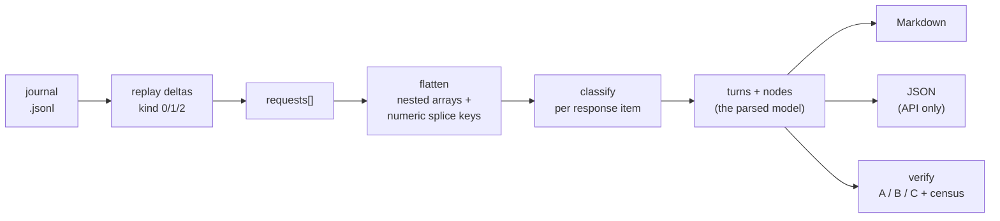

# copilot-chat-exporter

Export a VS Code Copilot chat session to a single, human-readable Markdown archive: prompts, agent
reasoning, tool calls, terminal output, code blocks, edited files, token cost, and timing.

The exporter reads VS Code's native chat journal (`chatSessions/<sessionId>.jsonl`) as the definitive
conversation source. The current GUI title comes from the workspace chat index in `state.vscdb`,
because a manual rename is not always written back to the journal. Other details are enriched
best-effort from the sibling `chat-session-resources`, `transcripts`, `debug-logs`, and `memory-tool`
stores. It only ever reads local files. See [docs/CHAT-SESSION-TITLES.md](docs/CHAT-SESSION-TITLES.md)
for the title fields, storage locations, precedence, and VS Code source references.

## Install

Zero runtime dependencies - Node built-ins only. Drop the folder into any repo, or add it as a
workspace member:

```jsonc
// host package.json
"workspaces": ["tools/*"],
"scripts": {
  "ai:export:chat": "node ./tools/copilot-chat-exporter/src/cli.ts"
}
```

Requires Node >= 22.18, where TypeScript type stripping is on by default, so `src/cli.ts` runs
directly with no build step. Run `npm run build` to emit the bundled `dist/` files used by the
package `bin` and import map. A git dependency runs the package's `prepare` hook and builds
`dist/` automatically because generated files are not committed.

The build has no runtime dependencies. `esbuild` is a development dependency used to bundle the
CLI and API; Node built-ins remain external. `npm pack --dry-run` is the quick check that the
bundle, license, README, docs and CI templates are the files that would ship.

## Build output

`npm run build` writes two bundles and TypeScript declarations into `dist/`:

| File | Built from | Purpose |
|---|---|---|
| `dist/cli.js` | `src/cli.ts` | the command-line entry. Carries a `#!/usr/bin/env node` shebang so it can run as an executable |
| `dist/index.js` | `src/index.ts` | the library entry. Exports `loadSession`, `renderSession`, `sessionToJson`, and the other public functions |
| `dist/*.d.ts` | `src/**/*.ts` | declarations for TypeScript library consumers |

Both bundles are ESM, target Node 22.18, and are built with `packages: 'external'`, so nothing is
inlined - they rely only on Node built-ins. Source maps are omitted because the original
TypeScript sources are already included.

**Why two files.** They serve two consumers, declared separately in `package.json`:
`"bin": { "copilot-chat-export": "./dist/cli.js" }` is the terminal command, and
`"exports": { ".": "./dist/index.js" }` is the `import` target. Keeping them apart means importing
the library does not pull in CLI argument parsing, and the CLI can carry a shebang the library
should not have.

**Entry points.** `dist/cli.js` (command `copilot-chat-export`) for the terminal;
`dist/index.js` for `import ... from 'copilot-chat-exporter'`.

**Running from `dist/`.** After `npm run build`:

```
node dist/cli.js <sessionId> out.md      # direct
node dist/cli.js                         # current session, default output
copilot-chat-export <sessionId> out.md   # via the bin name, once installed or linked
```

The `bin` and `exports` names resolve only after the package is published, linked (`npm link`),
or installed from the tarball or git, because it is `private: true` as a workspace member. During
development you do not need `dist/` at all: the scripts run the TypeScript sources directly (for
example `node src/cli.ts`) via Node type stripping. Build only when you are testing the shipped
artifact.

Install the Copilot skill and companion prompt into a repository with:

```
copilot-chat-export --install-skill <targetRoot>
```

The command creates or replaces `.github/skills/export-chat/SKILL.md` and
`.github/prompts/export-chat.prompt.md` under that explicit root.

## Usage

### Running it

List known sessions, then export one by id. Omit the id to export the current session
(`VSCODE_TARGET_SESSION_LOG`). During development, run the TypeScript source directly with
`node src/cli.ts`; after `npm run build` the same arguments work against `dist/cli.js`.

```
node src/cli.ts --list
node src/cli.ts <sessionId> docs/temp/name.md
```
> ```
> node ./dist/cli.js --list   
> node ./src/cli.ts ef6eb63d-269b-4166-aac8-34df2a71ae49 docs/temp/Migration-vite-svelte5.md
> ```


Every run re-reads the file it just wrote and self-checks it. A clean run ends with the session
summary and `Layer C self-check: all 9 render checks pass`:

```
Exported session ef6eb63d-269b-4166-aac8-34df2a71ae49:
Title: Migration-vite-svelte5
Custom Title: Project source file scanning request
First Prompt: Can u scan this entire project and all source files and update your model?
Last Prompt: on line 118 add check for other types of json geometry
Session from 260407 18:01 to 260414 16:49
Turns: 29; tool calls: 477; reasoning thoughts: 27; resources: 0.
Output: docs/temp/Migration-vite-svelte5.md (382,354 bytes)
Layer C self-check: all 9 render checks pass.
```

### Failed Run:
```
node ./src/cli.ts ef6eb63d-269b-4166-aac8-34df2a71ae49 docs/temp/Migration-vite-svelte5.md
Exported session ef6eb63d-269b-4166-aac8-34df2a71ae49:
Title: Migration-vite-svelte5
Custom Title: Project source file scanning request
First Prompt: Can u scan this entire project and all source files and update your model?
Last Prompt: on line 118 add check for other types of json geometry
Session from 260407 18:01 to 260414 16:49
Turns: 29; tool calls: 477; reasoning thoughts: 27; resources: 0.
Output: docs/temp/Migration-vite-svelte5.md (382,605 bytes)
Schema drift: 1 unhandled node kind(s) - mcpServersStarting=29. Run --verify for the full census.
Layer C self-check: 2 of 9 render checks FAILED.
  - [FAIL] tool badges == tool nodes (badges=472, nodes=477)
  - [FAIL] <details> balanced (scaffold-only) (endDepth=1, minDepth=0)
```

If a journal node kind is unrecognised, or a render check fails, the run reports it rather than
passing silently - for example `Schema drift: 1 unhandled node kind(s)` or `Layer C self-check:
2 of 9 render checks FAILED`, with each failed check named. `--strict` turns any of those into a
non-zero exit code, and `--verify` prints the full schema census.

### Package shortcuts

These are this package's own `package.json` scripts. Run them from the package directory
(`tools/copilot-chat-exporter`), or from a host repo that lists it as a workspace with
`-w copilot-chat-exporter`. Anything after `--` is passed straight to the CLI.

| Script | Runs | Purpose |
|---|---|---|
| `npm run export -- <sessionId> [out]` | `node src/cli.ts` | export a session; the current session when no id is given |
| `npm run list` | `node src/cli.ts --list` | list known sessions (id, date, title) |
| `npm run golden` / `golden:update` | `--golden check` / `update` | the small in-repo recorded check |
| `npm run snapshot -- update\|check <id>` | `node src/cli.ts --snapshot` | record or compare one of your own sessions |
| `npm run baseline` / `baseline:update` | `node test/baseline.ts` | the machine-local ~30 MB recorded check |
| `npm run test` | `node --test "test/*.test.ts"` | unit tests |
| `npm run typecheck` / `typecheck:test` | `tsc` over src / tests | type check, no emit |
| `npm run verify` | typecheck + typecheck:test + test + golden | everything a fresh clone can run |
| `npm run verify:local` | `verify` then `baseline` | the above plus the machine-local baseline |
| `npm run build` | `node scripts/build.mjs` | bundle `dist/`; also runs on `prepare` |

Flags without a dedicated script go through `export`:

```
npm run export -- --verify <sessionId> [renderedFile]
npm run export -- --verify --strict <sessionId>
npm run export -- --workspace-root <path> <sessionId>
npm run export -- --out-dir <path> <sessionId>
```

An explicit output path overwrites. With no path, the file is named
`YYMMDD_slug_<idPrefix>.md` - dated by the session's first turn, not by the export - so
re-exporting a growing conversation refreshes the same archive instead of creating copies.

Markdown is the only output format. There is no `--format` flag: see `sessionToJson` below if you
want the parsed model as data.

The output directory is the first of: `--out-dir`, `chatExport.outDir` in the workspace's
`package.json`, `outDir` in `.chatexportrc.json`, an existing `docs/chat-exports/`, then
`.copilot-chat-history/`. Add that last one to `.gitignore` if you do not want exports committed.

### From another program

```js
import { loadSession, renderSession, sessionToJson } from 'copilot-chat-exporter';

const loaded = await loadSession({ source: sessionId });
const markdown = renderSession(loaded, { outputPath, gitStatus, generatedAt });
const data = sessionToJson(loaded);
```

Nothing under `src/` prints or exits except `cli.ts`, so every step above is callable in-process.
`outputPath`, `gitStatus` and `generatedAt` are passed in rather than read, which is what makes
two renders of the same parse byte-identical.

`sessionToJson` returns the parsed model as plain data: every turn, node, tool call and per-turn
scalar, plus the schema census, with the raw journal excluded. Nothing in this package calls it,
and it is deliberately not a CLI flag - it is untruncated, so a long session runs to tens of MB
because every tool output is embedded whole. Reach for it only if you are writing a program that
needs the contents.

## Concepts

Start here if you are going to change the code. VS Code's chat storage is undocumented, and the
vocabulary below is used throughout the source, the spec, and `docs/UPGRADING.md`.

### Design principles

Six rules shape this codebase. Each was learned here, not imported from a style guide.

**1. The input is not ours, and it will change.** VS Code owns the chat format, ships changes
without notice, and publishes no schema. Everything else follows from that: parse into our own
model at the boundary, keep an alarm for shapes we do not recognise, and record which version we
were last known to work against.

**2. Never change behaviour without a mechanical way to notice.** Save a copy of the output
*before* refactoring, so every later step is pass or fail instead of an argument about a
difference. That is what makes restructuring 2,400 lines safe to attempt at all.

**3. Silence is the failure mode that matters.** A crash is cheap - somebody sees it. Quietly
dropping content is expensive, because nobody finds out. Hence the kind census, the warning
printed inside the exported document itself, and a `--strict` exit code. That machinery
immediately found a recorded file deletion that every previous export had dropped in silence.

**4. Optimize for the next human, not for tidiness.** Files are sized to be read. A module that
exports one or two things costs a reader another file to open without giving them another idea
to understand, so it does not get its own file. There is no `utils.ts` - a bucket defined by size
has nothing in common, and becomes the drawer everything imports and nobody owns. Split when a
file actually hurts, and write down why.

**5. Evidence over recall.** Never add a kind, an API, or a version number because it sounds
right. Fourteen names once sat on the suppression list purely from general knowledge of VS Code,
silently disarming the alarm built to catch them; the version marker shipped a wrong number for
the same reason. Verify against a real journal, then write it down.

**6. The tool is a guest in someone else's repository.** Zero runtime dependencies, nothing
hardcoded to the repo it grew up in, no writes to a project's root directory, and one folder that
can be copied out whole and still work.

### Where the data lives

VS Code keeps per-folder state under `workspaceStorage/<hash>/`, where `<hash>` identifies the
workspace, not the session:

```
workspaceStorage/<hash>/
  workspace.json                     names the folder this storage belongs to
  state.vscdb                        chat index; current GUI title keyed by session id
  chatSessions/<id>.jsonl            THE JOURNAL - definitive, this is what we parse
  GitHub.copilot-chat/
    chat-session-resources/<id>/     large tool-output bodies, keyed by toolCallId
    debug-logs/<id>/models.json      model id -> friendly name
    memory-tool/memories/<base64 id>/  memory and plan files
    transcripts/<id>.jsonl           A DIFFERENT SCHEMA - not the journal, see below
```

> **Trap:** `transcripts/<id>.jsonl` sits next to the journal and looks interchangeable. It is
> not. Passing it yields zero turns and silently overwrites a good export. Everything here parses
> `chatSessions/`.

Only `chatSessions/` is required. When `state.vscdb` or its chat index is unavailable, the title
falls back to the journal's latest root `customTitle`. The other four stores are best-effort
enrichment: VS Code rotates and empties `chat-session-resources/`, so nothing may depend on it
being present.

### Two terms you will see everywhere

**The parsed model.** VS Code's journal has its own shapes, which VS Code can change at any time.
So `session/` reads the journal once and converts it into shapes *this project* defines - a
`Session` holding `Turn`s holding `Node`s. Everything after that point works on those, never on
the raw journal. The benefit is simple: when VS Code changes, the change stops at the parser
instead of spreading into everything that draws the page.

**A recorded check.** Before changing anything, the export is run once and its output saved. Any
later change is compared against that saved copy, byte for byte. There are two: `golden` (a small
made-up session, kept in the repo) and `baseline` (a large real session, about 30 MB, kept only on
this machine).

> These only tell you the output *changed*. They cannot tell you the new output is *right*. So
> when you change something on purpose they are meant to fail, and the only safe move is to read
> the reported difference and confirm it is what you intended. Saving a new copy without reading
> the difference is how a bug becomes the expected result forever.

### Glossary

The distinction that causes the most confusion is which side of the pipeline a term belongs to.
A **turn** is an input concept; a **section** is an output concept. They are unrelated.

Side: `input` = VS Code's format, `parsed` = our own model, `output` = the Markdown document,
`verify` = the checking machinery.

| Term | Side | Meaning |
|---|---|---|
| journal | input | `chatSessions/<id>.jsonl`. The definitive record of a conversation |
| delta record | input | One line of the journal. `kind 0` = full snapshot, `1` = set value at a path, `2` = append at a path |
| request | input | One user prompt plus everything the assistant did in reply |
| response item | input | One entry in `request.response[]` |
| **kind** | input | The field that says what a response item is. **The part most likely to change between VS Code versions** |
| toolSpecificData | input | Per-tool payload hanging off a tool call: terminal output, todo list, subagent detail |
| resource | input | A large tool output stored out-of-band under `chat-session-resources/` |
| **turn** | parsed | A parsed request: prompt, ordered body nodes, cost, model, timing |
| **node** | parsed | One element of a turn's body. Five kinds: `text`, `think`, `ref`, `edit`, `tool` |
| tool call | parsed | A `toolInvocationSerialized`, deduplicated by `toolCallId` - the journal re-emits one per status change |
| **section** | output | One of the top-level `##` regions of the produced Markdown document |
| census | verify | Tally of kinds seen against kinds handled - the schema-drift alarm |
| recorded check | verify | A saved copy of a known-good export, compared byte for byte to catch unintended change |

### The pipeline



Flattening is not optional. A `response[]` contains nested arrays and numeric-keyed splice
objects such as `{"0": ...}`; skipping that step makes most tool calls disappear - an early
version reported 72 tool calls where the session had over 400.

### Which module owns what

Mapped at module level, so it survives ordinary refactoring. `docs/UPGRADING.md` has the
function-level detail you need while actually patching.

| Concern | Module |
|---|---|
| Storage discovery, workspace root, output path, git | `src/host.ts` |
| Finding, listing and resolving a session | `src/session/locate.ts` |
| Journal reading, delta replay, and the kind census | `src/session/journal.ts` |
| **Response item → node. Kinds live here** | `src/session/classify.ts` |
| Resources, memory files, versions, model names | `src/session/enrich.ts` |
| The parsed model itself | `src/types.ts` |
| Markdown output, one tool call up to the whole page | `src/markdown.ts` |
| The three checks | `src/verify/layers.ts` |
| The recorded checks and what a comparison ignores | `src/verify/golden.ts` |
| Load-then-render pipeline, and the parsed model as data | `src/index.ts` |
| Command-line flags and their usage messages | `src/args.ts` |
| Orchestration, and printing every report | `src/cli.ts` |

Everything above computes; only `src/cli.ts` prints. That is the line to hold when adding
anything: a function that reaches for `console.log` belongs in `cli.ts`, and one that does not
belongs in a module where a test can call it.

### When VS Code or Copilot changes

**You edit `classifyNode`.** Everything after it reads the parsed model and is unaffected. The
full procedure - diagnosing, deciding which of the three kind lists a new name belongs in, and
re-saving the recorded exports without destroying them - is in
[docs/UPGRADING.md](docs/UPGRADING.md).

## Layout

| Path | What |
|---|---|
| `src/cli.ts` | the entry point: arguments, orchestration, and printing every report |
| `src/args.ts` | what the user asked for: pure, so a test can ask it without running the tool |
| `src/index.ts` | the importable API: load a session, render it, or take the parsed model as data |
| `src/types.ts` | the parsed model: `Session`, `Turn`, `Node`. Start here |
| `src/text.ts` | colours, indents, and every value-to-string helper |
| `src/host.ts` | everything machine-specific: VS Code storage paths, workspace root, output location, git |
| `src/session/` | reading the journal: `locate`, `journal`, `classify`, `enrich` |
| `src/markdown.ts` | turning parsed turns into the Markdown document |
| `src/verify/layers.ts` | the three checks: journal vs parse, parse vs journal, parse vs rendered file |
| `src/verify/golden.ts` | the recorded checks: saved digest, saved copy, and what a comparison ignores |
| `docs/SPEC.md` | the contract: data sources, document layout, visual design, verification |
| `docs/CHAT-SESSION-SCHEMA.md` | visual guide to the observed journal tree, official source evidence, and schema-change workflow |
| `docs/UPGRADING.md` | **what to do when VS Code or Copilot changes the format** |
| `docs/BUILD-PROMPT.md` | rebuild or port the exporter from the spec |
| `docs/MIGRATION-PLAN.md` | target shape, portability rules, and the traps found extracting this |
| `skill/SKILL.md` | Copilot skill; copy into a host repo's `.github/skills/export-chat/` |
| `test/text.test.ts` | unit tests for `src/text.ts` |
| `test/host.test.ts` | unit tests for `src/host.ts` |
| `test/locate.test.ts` | unit tests for `src/session/locate.ts` |
| `test/classify.test.ts` | one test per handled journal kind |
| `test/enrich.test.ts` | unit tests for the optional stores beside the journal |
| `test/markdown.test.ts` | unit tests for the renderer |
| `test/verify.test.ts` | unit tests for the three checks and the recorded ones |
| `test/args.test.ts` | unit tests for command-line parsing |
| `test/index.test.ts` | unit tests for the pipeline, the document, and `sessionToJson` |
| `test/fixtures/golden/` | the saved small session, its digest, and its expected output |
| `ci/gitlab-ci.yml` | opt-in CI job for a GitLab host; inert until a pipeline includes it |
| `ci/github-workflow.yml` | CI workflow for a GitHub host; copy to `.github/workflows/` after extraction |
| `test/snapshots/` | digests of your own sessions, from `--snapshot update` (gitignored) |
| `test/baseline/` | generated exports (gitignored) |
| `test/baseline.ts` | replays one frozen real session and compares it to the saved copy |

## Verification

One command runs everything a fresh clone can run:

```
npm run verify       -w copilot-chat-exporter   # typecheck (src + tests), unit tests, golden
npm run verify:local -w copilot-chat-exporter   # the above plus the machine-local baseline
```

Or individually, cheapest first:

```
npm run typecheck -w copilot-chat-exporter    # catches a missing binding in seconds
npm run test      -w copilot-chat-exporter    # unit tests
npm run golden    -w copilot-chat-exporter    # small made-up session, kept in the repo
npm run baseline  -w copilot-chat-exporter    # large real session, this machine only
```

The type check must report zero. It is the first gate because it catches a missing binding in
seconds, which neither byte comparison can: both pass an explicit path, so a broken argument
branch short-circuits before it runs.

The last two compare against a saved copy, so they prove "nothing changed", never "this is
correct". They lock in current behavior, bugs included, and they only exercise the paths their
two sessions happen to take - a bug on any other path passes them both.

`--snapshot` is the answer to that last part. It records the *shape* of any session you have -
how many turns, how many thoughts per turn, which tool calls ran and in what order, which files
were touched, and the kind census - with prompts and answers stored as hashes rather than text.
A few KB even for a long conversation. So you can point the same before-and-after comparison at a
conversation containing something neither committed session has:

```
npm run snapshot -w copilot-chat-exporter -- update <sessionId>   # record it
# ...change the code...
npm run snapshot -w copilot-chat-exporter -- check <sessionId>    # see what moved
```

A failure names the field and the turn, so a newly handled node kind shows up as
`census.unhandled` emptying and the specific turns that gained content. Snapshots live in
`test/snapshots/` and are gitignored: they name a session that only exists in your VS Code
storage.

Two things to know. Snapshot conversations you have finished, not ones you are still in - VS Code
keeps appending to a live session's journal, so a later check would report drift from the new
turns rather than from your code. And a snapshot never announces a schema change by itself; the
census does that. [docs/UPGRADING.md](docs/UPGRADING.md) has the full loop.

Neither committed check would notice VS Code renaming a journal node kind, because both compare
the export against itself. `--verify` therefore also prints a **schema census**: every
response-item kind seen, which ones this build handles, and which produced no output. An unknown
kind means content is being dropped in silence; it is reported in the census, surfaced as a
warning inside the exported document, and fails the run under `--strict`.

The golden pair is small and kept in the repo, so it is the one CI can run. The baseline is a
~30 MB verbatim copy of a real workspace-storage session and is gitignored; the capture command
that recreates it is documented at the top of `test/baseline.ts`.

The golden fixture is hand-authored, but its *shapes* were transcribed from real journal nodes,
and its coverage is checked rather than assumed: every response kind and tool payload kind that a
real 73-turn session produces also appears in the fixture. Compare the two census blocks after any
change to that claim.

`ci/` holds two ready-to-enable jobs, one per host. Neither is active where you found it.

```yaml
# GitLab, while this package is a workspace member of another repo - add to its .gitlab-ci.yml:
include:
  - local: /tools/copilot-chat-exporter/ci/gitlab-ci.yml
```

```sh
# GitHub, once this package is its own repository:
cp ci/github-workflow.yml .github/workflows/verify.yml
```

Both run `npm run verify`, never `verify:local`, because no runner has the machine-local fixture.
The GitHub one runs a ubuntu/windows matrix: the recorded checks compare bytes and have only ever
been produced on Windows, so that matrix is what turns "machine-independent" from a claim into a
result.

Output is machine-independent: number formatting and sort order are pinned to `en-US`, and paths
resolve against the session's own workspace, so both checks pass from any working directory.

## Portability notes

The workspace root used for file links, line counts, and `git status` is read from the session's own
`workspaceStorage/<hash>/workspace.json`, so the tool is correct at any install depth and when
exporting a session that belongs to a different workspace than the one you are standing in. Override
with `--workspace-root <path>`.
