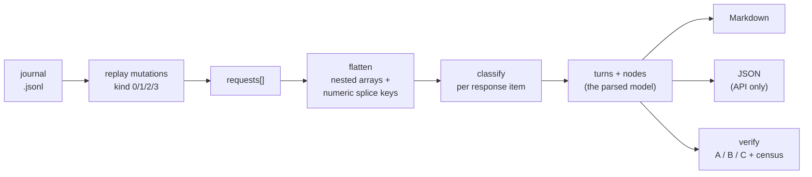

# copilot-chat-exporter

Export a VS Code Copilot chat session to a single, human-readable Markdown archive: prompts, agent
reasoning, tool calls, terminal output, code blocks, edited files, token cost, and timing.

The exporter reads VS Code's native chat journal (`chatSessions/<sessionId>.jsonl`) as the definitive
conversation source. The current GUI title comes from the workspace chat index in `state.vscdb`,
because a manual rename is not always written back to the journal. Other details are enriched
best-effort from the sibling `chat-session-resources`, `transcripts`, `debug-logs`, and `memory-tool`
stores. It only ever reads local files. See [docs/CHAT-SESSION-TITLES.md](docs/CHAT-SESSION-TITLES.md)
for the title fields, storage locations, precedence, and VS Code source references.

When a sibling transcript retains an `apply_patch` request, the Markdown links each touched file,shows submitted `+added` and `-deleted` operation counts, and includes the recorded patch in a collapsible `~~~diff` block. The journal remains authoritative for turn order and tool identity. Repeated edits count repeatedly, so these values are not a reconstruction of the final Git diff.
When patch arguments are unavailable, the export keeps the journal-derived file path and labels the change details unavailable instead of reporting the current file's total line count.

## Project goal

Capture every Copilot chat session on a machine, whatever its type or location, and export each one to a rich review artifact (Markdown first, HTML later) that keeps as much of what the Copilot chat shows as the stored data allows: prompts, readable reasoning, tool calls with inputs and outputs, file changes, models, credits, tokens, timing and code blocks. The purpose is review and playback (why and how something was done, including the human's and the model's reasoning) and confidence before a chat is deleted.

There are two stages. The listing reports (`--list`, basic and detailed HTML) identify every session and where its data lives. The export turns one session into the review artifact. The listing is complete for the stores the tool reads; export supports Local chats and Agent Host/Copilot CLI conversations, with Local fidelity work in progress. See [docs/SPEC.md](docs/SPEC.md) for scope, the source capability matrix and non-goals.

Principles: evidence before inference, unknown is never shown as zero, every omission is reported with a reason instead of hidden, and the tool only reads local files and never writes native VS Code or Copilot storage.

## Install

Zero runtime dependencies - Node built-ins only. Drop the folder into any repo, or add it as a
workspace member:

```jsonc
// host package.json
"workspaces": ["tools/*"],
"scripts": {
  "ai:export:chat": "node ./tools/copilot-chat-exporter/src/cli.ts"
}
```

Requires Node >= 22.18, where TypeScript type stripping is on by default, so `src/cli.ts` runs
directly with no build step. Run `npm run build` to emit the bundled `dist/` files used by the
package `bin` and import map. A git dependency runs the package's `prepare` hook and builds
`dist/` automatically because generated files are not committed.

The build has no runtime dependencies. `esbuild` is a development dependency used to bundle the
CLI and API; Node built-ins remain external. `npm pack --dry-run` is the quick check that the
bundle, license, README, docs and CI templates are the files that would ship.

## Build output

### Verification reports

`node src/cli.ts --verify --strict --json <session-selector> [export.md]` writes a machine-readable report. Local journals accept exact `.jsonl` paths. SDK chats use an exact qualified chat key from `--list`. Strict verification requires the pinned `markdown-it` dev dependency; it fails if the parser is unavailable. Exporting without verification still has no runtime dependencies.

Run `node scripts/verify-corpus.mjs --user-data-root "<Code user-data root>" --concurrency 6` to verify every source selected by the inventory. `--out` is optional. The default is `reports/corpus/corpus-<generatedAt in local time with UTC offset>.json`, with colons and periods replaced by hyphens. For example, `corpus-2026-10-20T23-32-34-259-04-00.json`. The full timestamp avoids overwriting an earlier run on the same date. Reports keep `generatedAt` in UTC for comparison. Reports are local-only and gitignored. They record per-source exit reasons, text categories, parser checks, image hashes, Local export sizes, and size/mtime before and after each run. Changed live originals are listed, but their frozen copies remain in totals. Only `--live` excludes changing sources. The 64-KiB Base64 heuristic remains a separate review trigger for other payloads.

Local prompt attachments and tool-result images now use the same companion helper as SDK image assets. Recorded bytes are saved unchanged, deduplicated by SHA-256, and linked at their prompt or tool position. Links show byte size and a short hash. No image is read from its recorded disk path or fetched from a URL. Unknown MIME types use `.bin` with a representation-change note. Images bypass text redaction and can contain private information. `--inline-images` is deferred.

Layer D verifies image bytes independently of the export decoder. Each unique image in a final Local request, or a kept SDK image event, must match a linked companion by SHA-256. Missing or corrupted companions fail verification. Reports separate unresolved images, reference-only images and excluded draft attachment records. See [the image policy](docs/SPEC.md#recorded-image-policy).

Library callers using `renderSession` must supply its `overflow` companion sink to save image artifacts. Without that destination, the Markdown reports unresolved images rather than inventing file links.

`npm run build` writes two bundles and TypeScript declarations into `dist/`:

| File | Built from | Purpose |
|---|---|---|
| `dist/cli.js` | `src/cli.ts` | the command-line entry. Carries a `#!/usr/bin/env node` shebang so it can run as an executable |
| `dist/index.js` | `src/index.ts` | the library entry. Exports `loadSession`, `renderSession`, `sessionToJson`, and the other public functions |
| `dist/*.d.ts` | `src/**/*.ts` | declarations for TypeScript library consumers |

Both bundles are ESM, target Node 22.18, and are built with `packages: 'external'`, so nothing is
inlined - they rely only on Node built-ins. Source maps are omitted because the original
TypeScript sources are already included.

**Why two files.** They serve two consumers, declared separately in `package.json`:
`"bin": { "copilot-chat-export": "./dist/cli.js" }` is the terminal command, and
`"exports": { ".": "./dist/index.js" }` is the `import` target. Keeping them apart means importing
the library does not pull in CLI argument parsing, and the CLI can carry a shebang the library
should not have.

**Entry points.** `dist/cli.js` (command `copilot-chat-export`) for the terminal;
`dist/index.js` for `import ... from 'copilot-chat-exporter'`.

**Running from `dist/`.** After `npm run build`:

```
node dist/cli.js <sessionId> out.md      # direct
node dist/cli.js                         # list sessions; never implicitly export
node dist/cli.js --current               # explicit current Local session
copilot-chat-export <sessionId> out.md   # via the bin name, once installed or linked
```

The `bin` and `exports` names resolve only after the package is published, linked (`npm link`),
or installed from the tarball or git, because it is `private: true` as a workspace member. During
development you do not need `dist/` at all: the scripts run the TypeScript sources directly (for
example `node src/cli.ts`) via Node type stripping. Build only when you are testing the shipped
artifact.

Install the Copilot skill and companion prompt into a repository with:

```
copilot-chat-export --install-skill <targetRoot>
```

The command creates or replaces `.github/skills/export-chat/SKILL.md` and
`.github/prompts/export-chat.prompt.md` under that explicit root.

## Usage

### Incremental discovery and export-policy APIs

The library now exposes `resolveUserDataRoot`, `discoverUserDataRoots` and `inventorySessions`. Root resolution accepts an explicit `userDataRoot`, auto-selects a single discovered root, and throws `UserDataRootError` with candidates when selection is ambiguous. An optional injected `choose` callback supports a host-owned chooser; the library itself never prompts.

`inventorySessions(userDataRoot, { copilotHome? })` returns workspace journal/index occurrences plus diagnostics and supplies both listing views. It retains index-only, provider and unknown entries even without an exportable backing; unreadable is not empty. It verifies Agent Host and Copilot CLI SDK backings and expands exact child scopes. The console groups only verified identities (and Local journals with matching session IDs and byte digests), reports prompt counts and evidence-based creation/activity dates, and keeps each displayed record on one line. It hides `/fix`, confirmed-empty and ambiguous entries by default; `--show-ignored` restores them and `--last25` limits output to the newest 25 after grouping/filtering. Main prompt counts exclude delegated prompts; a subagent row counts one verified delegation plus any separately recorded child-scope human `user.message` records. Workspace discovery currently covers `User/workspaceStorage` under the selected root; it does not claim profile/remote/cloud discovery completeness. The legacy `listSessions` API returns journal-only entries from one resolved root; use `inventorySessions` for the expanded inventory.

SDK files are read from explicit library `copilotHome`, otherwise `COPILOT_HOME`, otherwise `~/.copilot`. No provider is started and no storage is repaired. Agent Host central chat-catalog records take precedence over compatibility metadata; SDK IDs must match a single version 1 `session.start` header. Default-chat provider-ID fallback is allowed only when its local session database exists and the header matches, with a console warning and retained `identityWarnings` for the future Markdown renderer. This fallback is never used for peer chats or corrupt recorded mappings. `🟠 ❓` marks ambiguous scopes: an independently verified main chat stays available while affected children remain unresolved. Nested parent links require unique persisted tool-start evidence.

`createProviderSourceResolver({ copilotHome })` resolves an exact provider index key into `SdkEventSource` plus child scopes and evidence. Its per-inventory cache retains only scope/integrity metadata and rejects size/mtime changes; use a fresh resolver for a later inventory. `readSdkEvents(path, sdkSessionId)` retains complete event fields plus original `recordedLine` JSON text, including values JavaScript numbers cannot represent exactly. `eventsInScope(events, scope)` selects the verified main/child scope without moving or clipping records. These APIs verify backing identity, not semantic fidelity or complete Markdown support; later loaders must revalidate identity and SHA-256.

`planToolText` and `planMetadataText` implement the approved presentation thresholds without writing files or changing the existing renderer. Tool text up to 10 recorded lines stays inline, longer text collapses, and text over 300 lines AND over 15 KiB provides a 10-line preview and complete companion text. Unknown response payloads use OR: over 300 lines OR over 15 KiB moves them to a complete companion, with a preview capped at 2 KiB. A terminating newline does not add an extra line. Extra metadata always collapses. `PlannedArchive` separates pending companion bytes and diagnostics from Markdown; callers must not treat a planned link as a persisted file.

These additive contracts support the staged implementation. Both export commands write companions for tool text over 300 lines AND 15 KiB, and for unknown response payloads over either threshold. `--high-fidelity`, `--no-redact` and the fidelity flags are not yet wired into the CLI. Exports use the staged writer for safe publication. See [work-log.md](work-log.md) for current phase and validation.

`writeArchive({ outputPath, generatedAt, overwrite, plan })` persists a planned archive. Its pure `plan(assetsDirectory)` callback may run again after a folder-name collision; construct companion paths and relative Markdown links using that assigned name. It creates a timestamped sibling folder only when companions exist, saves/verifies their bytes, then stages/verifies/publishes Markdown. Ordinary publication refuses an existing file; explicit overwrite replaces it only after staging succeeds. Previous companions are never deleted. On failure it cleans only files created by that attempt and reports cleanup failures. Filesystems without hard-link support fail ordinary publication explicitly; there is no unsafe overwrite fallback. This is not a power-loss-proof multi-file transaction.

`redactContent(text, policy, location)` shares the legacy best-effort credential rules and returns replacement category/count/location diagnostics without matched values. Apply it before preview planning so inline text and complete companions use identical redaction. It does not sanitize image content. The writer preserves supplied bytes; it does not infer redaction from `archive.policy` or independently rewrite content. Consistent policy must be applied by the archive planner; the complete fidelity renderer and `--no-redact` CLI are still pending.

### Running it

#### Detailed identification report

The [HTML report design guide](docs/HTML-REPORT-DESIGN.md) documents the page/card outline, abbreviations, ID rules, typography, semantic colors, progressive disclosure and design rationale for both report levels.

Use `--detailed` alone or with `--list` to generate the combined detailed HTML report instead of basic HTML. Console output stays compact and unchanged. The default filename is `copilot-chat-sessions-detailed-listing-<timestamp>.html` in the invoking directory; `--html-output`, `--overwrite`, ignored-session rules and root selection behave as before. `--detailed --no-html` produces only the console listing and prints an explicit conflicting-flags warning. Detailed mode is listing-only, not an export format.

Choose an optional encoding for a smaller, directly openable detailed HTML file. Conventional HTML remains the default. Both compressed encodings require `--detailed`, reject `--no-html`, and preserve naming, root selection and overwrite protection.

| Flags | Encoding and requirements |
| --- | --- |
| `--detailed` | Conventional HTML, including detailed evidence without JavaScript |
| `--detailed --compressed` | Gzip alias, requiring JavaScript and native browser gzip decoding |
| `--detailed --compression gzip` | Explicit gzip, same as `--compressed` |
| `--detailed --compression brotli` | Brotli quality 8, requiring JavaScript and WebAssembly |

Example: `node src/cli.ts --list --detailed --compression brotli --html-output temp-tool-output/detailed-brotli.html`. `--compressed --compression brotli` is an error because the alias selects gzip. Repeating the same selection with `--compressed --compression gzip` is allowed. Neither encoding needs a CDN, fetches or runtime npm dependency. Brotli embeds a pinned decoder and license notices, and permits WASM compilation through CSP `wasm-unsafe-eval` (not general JavaScript `unsafe-eval`). Its fixed decoder overhead makes it a poor choice for some small reports; there is no automatic codec selection.

The compressed report shows the header, count cards, overview graphs, Chats per project and the complete expandable Session TOC before loading detailed evidence. It retains your latest filters and applies links once ready. Detailed evidence, report search and browser Find over cards require JavaScript, the selected decoder and completed loading. Without JS, the overview/TOC remain readable; unsupported browsers, blocked WASM or corrupt payloads show a message to regenerate without `--compressed` or `--compression`. Compression reduces file bytes, not DOM size, and can increase startup memory. It is not encryption, authentication or guaranteed credential sanitization. Use conventional HTML for no-JS archives.

Compressed files tolerate CRLF conversion, trailing-whitespace trimming, Windows-1252 re-saving and whitespace wrapping of payload/WASM base64. The shell is ASCII-encoded without losing Unicode text or CSS glyphs, and executable loader/decoder code is minified onto one ASCII-only line. Each report uses a content-derived script nonce while retaining CSP hashes; format-only edits can therefore change a script hash without blocking execution. The nonce is SHA-256 over a version prefix, codec, complete conventional HTML and executable loader, with NUL-separated fields. It is predictable, not a security secret or tamper authentication, and is intended only for self-contained offline report re-save resilience. Identical input and codec produce byte-identical compressed HTML with the same toolchain. Changing timestamps or evidence changes the output.

Altered payload bytes must still pass codec integrity checks. Before insertion, decoded evidence is parsed in an inert template and checked for script elements, `on*` attributes and `javascript:` attribute values, including entity/control-character obfuscation and nested templates. Literal script text in escaped prompts remains readable. This targeted guard is not a general-purpose untrusted-HTML sanitizer, and arbitrary HTML/editor rewrites are not guaranteed safe.

When Brotli's complete output is larger than gzip would be, the CLI warns with both byte counts and recommends `--compression gzip`; it still writes the requested Brotli file. Library calls remain silent.

Maintainers: the exact `brotli-dec-wasm@2.3.2` development dependency generates the browser assets in [brotli-decoder.ts](src/generated/brotli-decoder.ts). `npm run build` regenerates them; `npm run generate:brotli` runs only that step. `npm run verify` first runs read-only `verify:generated`, checking the installed decoder version, pinned WASM SHA-256 and reproducibility of the generated decoder/loaders, WASM and notices. Stale or modified assets fail without being rewritten. Commit the generator, pinned lockfile, notices and generated assets together. Generated CLI/library bundles and reports require no decoder installation. Keep [upstream notices](docs/BROTLI-NOTICES.txt) and the generated package license with any decoder update.

The repository's compressed-report browser tests enforce actual CSP, including negative controls, without disabling web security. They locate Chrome/Edge on Windows or Chromium/Chrome on Linux; set `CCE_TEST_BROWSER` to an explicit Chromium-family executable to select another installation. Without a detected browser the suite reports a visible skip; an invalid explicit path fails. Firefox is not covered by this CDP test harness.

The detailed report includes ordered prompt previews/full text, per-turn local dates, selected versus recorded answering models, Auto/effort, historical edit evidence and editing-history state, title/date provenance, artifacts, source grids, verified parent/child/peer navigation, recorded SDK forks and separately labelled best-effort copy/fork hints. It also provides full-text/project/file/model search, conjunctive quick chips, date/numeric known/unknown ranges, grouped/occurrence views, model-switch navigation, two-chat summary comparison, charts and collapsible explanatory sections. Native disclosures and all main cards remain readable without JavaScript; interactive filtering, copying and comparison require it.

Why/source now consolidates health/audit notes, workspace references, a compact recorded-evidence chain, conditional per-reference lineage, storage summary and a collapsed unified evidence table. Technical identity is a nested disclosure preserving each field/value/reference association instead of claiming all references are identical. Reference labels describe persisted index entries, derivation through a parent, observed cwd matches and additional workspace references; they do not assign primary/copy ownership. Artifact rows retain purpose, sharing within the inventoried report, full-path copy/link controls and qualified potential removal impact. No cleanup is performed. Sizes emphasize the bold abbreviated value and keep exact comma-separated bytes regular and small in Arial Narrow.

Detailed enrichment inspects each unique storage artifact once per report. Workspace databases use read-only transactions for page counts, logical UTF-8/blob value totals and largest keys; no stored prompt-history bodies are exposed. JSONL composition groups actual byte lengths by recorded type/mutation, while related directories group regular-file lengths by immediate child without following links. Composition is omitted if a file/WAL changes during analysis. These are separate physical, logical, directory and conversation-scope measures, not additive totals or reclaimable-space estimates. The report remains a live best-effort filesystem observation, not an atomic backup. See [the storage guide](docs/CHAT-SESSION-LOCATIONS.md) for the evidence routes and limitations.

Cards start collapsed, with type-colored borders/titles, a title/tag line and two compact metadata lines. Open a card to see title provenance immediately, then prompts and other disclosures. The top-linked collapsible session TOC includes ignored/limited entries; following a link reveals its target. Comprehensive mode opens cards and their inner sections. Duplicate title values share one row with all source labels, and `--show-ignored` does not repeat full cards in the bottom ignored index.

Child headings prefer a real recorded workspace-reference title, then the uniquely bound delegation description/name or child display name. Only when these are unavailable is `Subagent (parent title)` used as a labelled fallback. The heading and inherited parent workspace are presentation aids, not new identity evidence. Short complete prompts are not repeated in a full-text disclosure; clipped or derived previews retain one. Local recorded credits and input/output tokens appear in header and per-turn chips, and in a credits/tokens disclosure after the titles when available. Partial values use `~`; credits and detailed token totals round up to whole units, while the token chip shows `⬆️` prompt and `⬇️` completion counts as `k`/`M` rounded to the nearest unit (for example `⬆️~15.4M ⬇️~730k`). When usage is unavailable, the expanded card shows one `Usage unavailable` chip in place of the disclosure; header and turns omit unavailable usage chips. Missing answering-model evidence is stated only inside the expanded card. Unknown values show `?` (minor detail), `??` (headline value such as turns or a date) or `???` (the source could not be read or verified at all) with the reason in a tooltip. Sections with nothing or one line to show (audit flags, family, a single-entry model timeline, the export selector) are `icon label: value` lines instead of disclosures. Prompts that differ only by whitespace are not repeated. The updated date is omitted when it equals created. Chips say `MD` for Markdown. Compare, Link and 🔝 TOC are small Arial Narrow controls at the top right of the expanded card. The `N w/s refs · 1 conv` chip is bold magenta; `⑂?` marks tentative fork/copy hints. All font sizes are `rem` on a 125% root (change `html{font-size}` in the stylesheet to rescale the whole report); `rem` follows the browser's default font size, unlike `px`. Model labels share one Arial Narrow chip, titles are smaller Arial Narrow, and created/updated icons retain descriptive tooltips. Dates keep non-prompt provenance visible inside an open card, with request/prompt timestamps collapsed separately. Byte counts use commas plus binary-scaled MB.

Detailed turn counts include every recorded child delegated task and follow-up; compact console counts retain their existing human-prompt policy. SDK detailed created/updated dates use the first/last valid recorded event in the exact scope, not filesystem dates or just the last user/assistant message. Headers, TOC, initial newest-25 selection, filters, sorting and occurrence rows share these rich metrics. The compact inventory count remains available in the expanded comparison summary. A child header labels its exact scope ID as `agentID`; the provider/native key and backing SDK session ID remain in source details.

Long prompt previews use exactly the first 50 and last 20 whitespace-delimited words above 70 words, separated by `. . . . .`; full redacted text is retained. Turn dates omit the year only when creation and turn timestamps share a known generator-local year. Model labels are shortened for display but raw IDs remain in tooltips, filters and the model inventory; aliases are not silently merged. A selected model alone is not counted as proof of an answering model.

These are identification aids, not a near-lossless export or complete audit of every private storage field. Unknown remains different from zero. Edit counts describe submitted tool changes or labelled marker estimates, not current filesystem diffs or Keep/Undo decisions. Missing/malformed edit arguments are marked partial. Changed backings are not enriched. SDK sizes describe exact scoped event-record bytes, excluding separators and unrelated scopes; Local journal and optional artifact bytes are separate. Never sum these figures as unique disk usage.

The report contains private prompts and local paths. Prompt/title text uses the existing best-effort credential redactor, but this is not complete sanitization. Keep generated reports private.

Local artifact counts use the same five session-keyed locations as the sister tool: journal, editing-session directory, transcript, debug-log directory and resource directory. Each location has present/missing/unreadable state and a stat-based byte/file count. Individual resource files are listed separately. The audited Local payload includes the journal once and is not additional to journal bytes or a globally deduplicated disk total.

#### Listing and export commands

List known sessions, then export one by id or exact journal path. No arguments means listing, even when `VSCODE_TARGET_SESSION_LOG` is set. Use `--current` to request a verified current Local session explicitly; missing/conflicting identity never falls back to newest. An output path alone is no longer an export selector. During development, run the TypeScript source directly with
`node src/cli.ts`; after `npm run build` the same arguments work against `dist/cli.js`.

```
node src/cli.ts --list
node src/cli.ts --list --user-data-root "C:\Users\you\AppData\Roaming\Code"
node src/cli.ts --list --last25 --user-data-root "C:\Users\you\AppData\Roaming\Code"
node src/cli.ts --list --show-ignored --user-data-root "C:\Users\you\AppData\Roaming\Code"
node src/cli.ts --list --full-ids --user-data-root "C:\Users\you\AppData\Roaming\Code"
node src/cli.ts --list --no-html --user-data-root "C:\Users\you\AppData\Roaming\Code"
node src/cli.ts --detailed --user-data-root "C:\Users\you\AppData\Roaming\Code"
node src/cli.ts --list --detailed --html-output temp-tool-output/detailed-listing.html --user-data-root "C:\Users\you\AppData\Roaming\Code"
node src/cli.ts --list --html-output docs/temp/chat-list.html --user-data-root "C:\Users\you\AppData\Roaming\Code"
node src/cli.ts --current docs/temp/current.md --user-data-root "C:\Users\you\AppData\Roaming\Code"
node src/cli.ts <sessionId-or-unique-prefix> docs/temp/name.md
```

Listing writes a self-contained offline HTML report in the invoking directory by default and prints its path. Use `--no-html` to suppress it or `--html-output <path>` to choose a destination. Existing reports are preserved unless `--overwrite` is explicit; no browser opens automatically. The report includes searchable, sortable and filterable rows, inventory charts, copyable selectors, row-level source explanations, and a linked collapsible guide to storage paths, unknown values, statuses, ambiguities and coverage limits. Its table remains readable without JavaScript.

For development and review in this repository, put generated reports, runtime captures, test output and validation logs in the Git-ignored `temp-tool-output/` directory. Pass `--html-output temp-tool-output/<report-name>.html` for listing reports and use timestamped log names to preserve earlier runs. This is a development convention, not a change to the CLI default. Automated test fixture sandboxes still use their existing temporary locations and cleanup.

HTML dates use the generator's local time in `YYMMDD_HH:MM` format, with smaller Arial Narrow styling for dates and selectors and bold prompt counts. Each “Why / source” section includes full IDs, workspace storage hash, recorded folder/workspace URI, URI-basename labels, provenance, diagnostics and local path/JSONL links. Missing metadata stays unknown; multi-root project folders are not inferred. Links do not guarantee that a file still exists, and browsers may restrict opening them. All ignored sessions are retained in a separate collapsed section at the bottom, independently of `--last25` and the main-table filters. `--show-ignored` also includes them in the main table and console.

“Why / source” opens a full-width panel directly below its session, with separate conversation identity, workspace/project, and files/locations cards. Panels remain attached to their session while sorting and hide with their session while filtering. Each has a close control that returns keyboard focus to its toggle. Without JavaScript, native disclosure controls below each row keep all details accessible.

The listing summary says how many grouped conversations are shown out of the eligible total; ignored entries and duplicate source occurrences are counted separately. Unknown creation dates remain `unknown` rather than using filesystem modification times.

The listing has a `TYPE` column (`local`, `agent`, `sub-agent`, or `CLI agent`) and an `ID/PREFIX` column. UUIDs display as the shortest unique hexadecimal prefix of at least eight characters, without an ellipsis, so the value can be copied directly as the export selector. `--full-ids` displays complete UUIDs; the ID column expands as needed. Local ID and prefix lookup searches workspace journals and `globalStorage\emptyWindowChatSessions` under the selected user-data root. A unique UUID or prefix resolves without a path. An ambiguous prefix reports the matching IDs and accepts a longer unique prefix or exact `.jsonl` path. If one ID occurs in multiple journal files, the listing marks it `path required`, and the CLI reports each location and requires an exact path, even with `--full-ids`. A missing ID points to `--list`, `--user-data-root` and exact-path selection.

`verified` means the corresponding journal/event backing was found and its identity checked; it does not necessarily mean that Markdown export is implemented for that provider. `unresolved` means the listing has an index/reference but no verified conversation backing. `ambiguous` / `🟠 ❓` means the inventory could not safely identify one backing or child scope. Unknown creation dates or prompt counts mean no trustworthy source value was available, not zero. To reduce placeholders, `New Chat` rows with both creation date and prompt count unknown are hidden by default and restored by `--show-ignored`.

Multiple discovered roots prompt for a numbered selection only in an interactive terminal. Non-interactive use fails with candidate paths and `--user-data-root` remediation; it never picks the first root. Explicit journal paths validate Local format/identity without scanning unrelated roots. Current Agent Host/SDK main-conversation export is available by chat ID, backing ID or prefix (see "Exporting an Agent Host or Copilot CLI chat"); the detailed listing marks each exportable agent chat and shows its copy-ready export command. Listing distinguishes verified backing identity from unresolved sources and does not export guessed conversations.
> ```
> node ./dist/cli.js --list   
> node ./src/cli.ts eeeeeeee-1111-4111-8111-111111111111 docs/temp/Migration-vite-svelte5.md
> ```


Every Markdown export re-reads the file it just wrote and self-checks it. A clean export ends with the session
summary and `Layer C self-check: all 9 render checks pass`:

```
Exported session eeeeeeee-1111-4111-8111-111111111111:
Title: Migration-vite-svelte5
Custom Title: Project source file scanning request
First Prompt: Can u scan this entire project and all source files and update your model?
Last Prompt: on line 118 add check for other types of json geometry
Session from 260407 18:01 to 260414 16:49
Turns: 29; tool calls: 477; reasoning thoughts: 27; resources: 0.
Output: docs/temp/Migration-vite-svelte5.md (382,354 bytes)
Layer C self-check: all 9 render checks pass.
```

### Failed Run:
```
node ./src/cli.ts eeeeeeee-1111-4111-8111-111111111111 docs/temp/Migration-vite-svelte5.md
Exported session eeeeeeee-1111-4111-8111-111111111111:
Title: Migration-vite-svelte5
Custom Title: Project source file scanning request
First Prompt: Can u scan this entire project and all source files and update your model?
Last Prompt: on line 118 add check for other types of json geometry
Session from 260407 18:01 to 260414 16:49
Turns: 29; tool calls: 477; reasoning thoughts: 27; resources: 0.
Output: docs/temp/Migration-vite-svelte5.md (382,605 bytes)
Schema drift: 1 unhandled node kind(s) - mcpServersStarting=29. Run --verify for the full census.
Layer C self-check: 2 of 9 render checks FAILED.
  - [FAIL] tool badges == tool nodes (badges=472, nodes=477)
  - [FAIL] <details> balanced (scaffold-only) (endDepth=1, minDepth=0)
```

If a journal node kind is unrecognised, or a render check fails, the run reports it rather than
passing silently - for example `Schema drift: 1 unhandled node kind(s)` or `Layer C self-check:
2 of 9 render checks FAILED`, with each failed check named. `--strict` turns any of those into a
non-zero exit code, and `--verify` prints the full schema census.

`--verify` also prints **Layer D**, an independent check that recorded content (prompts, answers, reasoning, tool input and output, errors) is present in the Markdown. It reports per category how many pieces are present, partial or absent. Partial or absent text fails even without `--strict`. Source-safe message order and repeated occurrences are checked only for Local prompts/prose and SDK prompt/reasoning/prose/tool-intent streams grouped by agent scope. Other text is presence-only. See [SPEC section 9](docs/SPEC.md) for its limits.

### Historical verification limitations

- Earlier verification of saved SDK files regenerated the export instead of reading the supplied file. A passing result did not prove the saved file or its companions were intact. Re-verify with the corrected file check.
- Layer D before October 20, 2026 did not cover images. Those results describe text coverage, not image preservation. Current image verification checks recorded bytes against linked companions independently by SHA-256.

### Exporting an Agent Host or Copilot CLI chat

```
npm run export -- <chat id | backing id | prefix of 8+ characters> [outputPath] [--user-data-root <path>]
```

The selector is matched against the verified agent chats of the selected root. The command exports the main conversation: your prompts, readable reasoning (thinking text or the model-written summary; reasoning stored only as an encrypted token is counted but cannot be read), assistant messages, tool calls with readable arguments, outputs, errors and diffs, compaction summaries and model changes. System prompts, skill files and images are written as linked files in a sibling `_assets_<timestamp>` folder. Local and agent exports both save tool text over 300 lines and 15 KiB the same way: the Markdown shows the first 10 lines and links a file with the full text, so nothing is clipped. Permission prompts, hook records and model request copies are counted and left out; the closing "Left out of this export" section lists the counts. Sub-agent conversations are nested inline at their delegation point, collapsed and labelled. Usage is shown as AI credits (recorded nano-AIU divided by 1,000,000,000; 1 credit = $0.01) per model, per turn and per sub-agent, from the Copilot CLI session store (`~/.copilot/session-store.db`) or the log's own usage events, with the number of usage rows against the assistant replies and the last logged session total. Credits are never estimated from token counts; where nothing was recorded the export says "not recorded", never zero. Chats without per-call rows still get credits per turn, taken from the differences between the log's running totals (labelled "from running totals"; a difference that covers several turns is shown as a range), with the most expensive turns listed in the Cost section. The exporter only reads the event log; it never deletes or changes it. Policy and rationale: `docs/SPEC.md`, "Agent chat export policy".

### Package shortcuts

These are this package's own `package.json` scripts. Run them from the package directory
(`tools/copilot-chat-exporter`), or from a host repo that lists it as a workspace with
`-w copilot-chat-exporter`. Anything after `--` is passed straight to the CLI.

| Script | Runs | Purpose |
|---|---|---|
| `npm run export -- <sessionId> [out]` | `node src/cli.ts` | export an explicit session; no arguments lists; `--current [out]` requests current Local |
| `npm run list` | `node src/cli.ts --list` | list known sessions (id, date, title) |
| `npm run golden` / `golden:update` | `--golden check` / `update` | the small in-repo recorded check |
| `npm run snapshot -- update\|check <id>` | `node src/cli.ts --snapshot` | record or compare one of your own sessions |
| `npm run baseline` / `baseline:update` | `node test/baseline.ts` | the machine-local ~30 MB recorded check |
| `npm run test` | `node scripts/test.mjs` | unit tests in an isolated cache, with a real-cache write guard |
| `npm run typecheck` / `typecheck:test` | `tsc` over src / tests | type check, no emit |
| `npm run verify` | typecheck + typecheck:test + test + golden | everything a fresh clone can run |
| `npm run verify:local` | `verify` then `baseline` | the above plus the machine-local baseline |
| `npm run build` | `node scripts/build.mjs` | bundle `dist/`; also runs on `prepare` |

For commits in this repository, enable [the commit-message hook](.githooks/commit-msg) with `git config core.hooksPath .githooks`. It removes Copilot co-author trailers, keeps other authors and body text, and requires Node.js on `PATH`. The hook is tested through a real commit in a temporary repository.

The corpus runner snapshots its inputs before inventory or verification. Journals, SDK events and relevant metadata are copied into an isolated temporary tree. SQLite inputs, including workspace/global state, Agent Host metadata and SDK usage, use SQLite's backup API so WAL data is included. Each copy records its byte size and SHA-256. Report version 7 pairs run-local labels such as `S023` with a stable `sourceId`: the first 12 SHA-256 characters of the original absolute source path, normalized for separators and Windows case. Labels can change between runs. The identifier stays the same when the source grows or its capture moves, but changes if the original path moves. Original sources that change through run end are listed but their frozen results remain in totals. `--live` keeps the old behavior, which excludes changing sources. Use `--snapshot-dir <new-folder>` to keep the frozen inputs for later comparisons. These are per-file snapshots, not an atomic snapshot across all sessions or databases.

Single-chat exports capture the selected source before parsing. One incomplete final JSONL record is skipped with an archive notice; malformed earlier records still fail. The header reports a source that changed during capture, with the local copy time and UTC offset. Only the trimmed event log is kept. Its manifest records the untrimmed byte size and SHA-256 when trimming was needed, without a second `.recorded` file. These are per-file captures, not an atomic snapshot across the event log and usage transaction.

SDK selection reads live indexes and identity mappings without waiting for event logs to stop growing. The private capture contains that chat's event log, selected identity/index metadata and a small SQLite usage database. Usage extraction selects that backing session's rows, including child agents, in a read-only transaction. Unrelated sessions, tables and full state/catalog databases aren't copied. Event identity is checked on the fixed copy before export. A missing usage database keeps the existing event-usage fallback.

Local captures keep the journal, selected index metadata instead of the whole workspace database, supplementary resources, transcript and model catalog. They also keep the session/repo/user Markdown memories rendered in the archive, not unrelated memory subdirectories. Export provenance keeps original locations while replay reads captured bytes.

### Private source cache

Set `CCE_CACHE_DIR` to override the shared root for captures, receipts and snapshot registrations. Never point it into native session storage. Cached native payloads are private and never become Markdown companions.

| Platform | Default root |
|---|---|
| Windows | `%LOCALAPPDATA%\copilot-chat-exporter\cache` |
| macOS | `~/Library/Caches/copilot-chat-exporter/cache` |
| Linux | `$XDG_CACHE_HOME/copilot-chat-exporter/cache`, or `~/.cache/copilot-chat-exporter/cache` |

These defaults avoid the temporary directory. Manual removal or OS cache policies can still remove kept copies. `--cache` also reports old temporary cache and receipt folders without migrating or deleting them.

| Action | Source copy |
|---|---|
| Normal export | Checks persisted staged Markdown and linked companions before publication, then deletes the capture after success |
| Export with `--keep-source` | Keeps the capture and adds a header notice |
| Export verification fails or throws | Keeps a warning-marked `.verify-failed.md`, companions, diagnostic log, capture and receipt; exits nonzero |
| `--verify <source>` | Checks a temporary capture; removes it on success and keeps it with a diagnostic log on failure |
| `--verify <source> <export.md>` | Requires the kept capture associated with that output path and exact selector; never substitutes live data |
| Re-export to the same output | Removes the old capture and its receipt before installing the new receipt |

Without `--keep-source`, a small receipt records that the source wasn't kept. Later file verification explains this and suggests re-exporting with `--keep-source`. A missing kept capture is a separate error. Kept captures have no automatic age expiry or size cap. Manual/OS removal can still make them unavailable.

```sh
node src/cli.ts <source> export.md --keep-source
node src/cli.ts --cache
node src/cli.ts --clean --older-than 7 --dry-run
node src/cli.ts --clean --older-than 7
node src/cli.ts --clean --older-than 7 --yes
node src/cli.ts --clean --include-corpus --yes
```

`--cache` reports sizes, creation times, affected exports and in-use status. It also lists failure logs directly under the cache's `failures` directory. `--clean` lists targets before doing anything. Deletion requires `--yes` or an interactive answer of `yes`/`y`; the prompt defaults to No. Without a terminal, the command lists and deletes nothing unless `--yes` is supplied. `--dry-run` always lists without deleting, even with `--yes`. Retained corpus snapshots are skipped unless `--include-corpus` is passed. `--older-than N` uses capture creation age and cached-log modification age in days. Cleanup rechecks the listed ownership identity and active readers before deleting a capture and its linked receipts. Cached logs are also rechecked against their preview identity. Symlinks/junctions, unknown directories and in-use captures are protected. Legacy snapshots without a registration aren't cleanup targets. Single-chat commands never remove a borrowed corpus snapshot. Failure logs beside exports aren't cleanup targets.

Failed export verification exits nonzero with or without `--strict` or `--keep-source`. It publishes `<name>.verify-failed.md` instead of the normal name, without replacing an earlier successful archive, even with `--overwrite`. The warning at the top lists failure reasons, category counts, up to five missing/partial text locations and the kept capture path. Additional locations are counted as "and N more". Artifact metadata and the log name the actual failed Markdown, including collision suffixes. Companions remain beside it with working relative links. Existing failures aren't replaced: collisions use `.verify-failed-1.md`, then increasing suffixes. A later successful export writes the normal name and reports older failed archives without deleting them. An incomplete trailing active-chat record alone isn't a failure.

Each failed export writes a private `failed-<sessionid>-YYMMDD_HHMMSS.log` beside the failed Markdown. The log and companion-folder timestamps both use local time. The log starts with a privacy warning followed by JSON, so the whole file isn't a JSON document. It contains check results, counts, errors, runtime/command details, source hash, capture location, exporter version and recorded VS Code/Copilot versions. Missing recorded versions say `unknown` or `not recorded`, never the current installation's version. The console reports a short failure summary, the first few missing locations and log path, not the full JSON report. Standalone `--verify` leaves supplied Markdown unchanged and writes failure logs under the configured cache's `failures` directory. Logs may contain session content through error messages or arguments. Credential redaction is best effort; review logs before sharing.

Post-export verification reads the saved staging file and its linked companions from disk. Both Local and SDK reports identify that target as `file`; in-memory checks remain labelled `in-memory`.

Export provenance shows the package version beside the Git build identity. `npm run build` embeds `git describe --always --dirty` in both bundles; building requires Git metadata. Failure logs record both as `exporterVersion` and `exporterCommit`. Source-mode exports say `source (not built)` instead of claiming a build commit. **Export generated** uses local time with a UTC offset.

Tests, golden checks and baselines run under isolated cache roots and remove them afterward. The runner fails if the real default cache or legacy receipt/capture stores change. For selected tests, use `node scripts/test.mjs test/source-snapshot.test.ts test/cli.test.ts`, not bare `node --test`.

Layer D verification fails on partial as well as absent text, even without `--strict`. Schema drift and early fence repairs remain additional strict checks. There are no approved partial-cause exceptions. A future exception needs a named cause and evidence for that individual piece, not an exemption for a whole category.

Flags without a dedicated script go through `export`:

```
npm run export -- --verify <sessionId> [renderedFile]
npm run export -- --verify --strict <sessionId>
npm run export -- --workspace-root <path> <sessionId>
npm run export -- --out-dir <path> <sessionId>
```

An existing archive destination is refused unless `--overwrite` is supplied. With no path, the file is named
`YYMMDD_slug_<idPrefix>.md` - dated by the session's first turn, not by the export - so
re-exporting a growing conversation targets the same archive; pass `--overwrite` to refresh it deliberately.

Markdown is the only output format. There is no `--format` flag: see `sessionToJson` below if you
want the parsed model as data.

The output directory is the first of: `--out-dir`, `chatExport.outDir` in the workspace's
`package.json`, `outDir` in `.chatexportrc.json`, an existing `docs/chat-exports/`, then
`.copilot-chat-history/`. Add that last one to `.gitignore` if you do not want exports committed.

### From another program

```js
import { loadSession, renderSession, sessionToJson } from 'copilot-chat-exporter';

const loaded = await loadSession({ source: sessionId });
try {
  const markdown = renderSession(loaded, { outputPath, gitStatus, generatedAt });
  const data = sessionToJson(loaded);
} finally {
  await loaded.dispose();
}
```

Library callers release their temporary capture with `loaded.dispose()` after rendering/checking. Process exit also cleans unfinished temporary captures. Borrowed `snapshotCopy` inputs aren't deleted by `dispose()`.

`loadSession()` and `resolveSession()` no longer select an implicit current/newest session. Pass `source`, or explicitly pass `{ current: true, userDataRoot }`. UUID-based library calls and `listSessions({ userDataRoot })` resolve one root without prompting; ambiguity is an error. An exact Local journal path can be read independently of discovered installations.

Nothing under `src/` prints or exits except `cli.ts`, so every step above is callable in-process.
`outputPath`, `gitStatus` and `generatedAt` are passed in rather than read, which is what makes
two renders of the same parse byte-identical.

`sessionToJson` returns the parsed model as plain data: every turn, node, tool call and per-turn
scalar, plus the schema census, with the raw journal excluded. Nothing in this package calls it,
and it is deliberately not a CLI flag - it is untruncated, so a long session runs to tens of MB
because every tool output is embedded whole. Reach for it only if you are writing a program that
needs the contents.

## Concepts

Start here if you are going to change the code. VS Code's chat storage is undocumented, and the
vocabulary below is used throughout the source, the spec, and `docs/UPGRADING.md`.

### Design principles

Six rules shape this codebase. Each was learned here, not imported from a style guide.

**1. The input is not ours, and it will change.** VS Code owns the chat format, ships changes
without notice, and publishes no schema. Everything else follows from that: parse into our own
model at the boundary, keep an alarm for shapes we do not recognise, and record which version we
were last known to work against.

**2. Never change behaviour without a mechanical way to notice.** Save a copy of the output
*before* refactoring, so every later step is pass or fail instead of an argument about a
difference. That is what makes restructuring 2,400 lines safe to attempt at all.

**3. Silence is the failure mode that matters.** A crash is cheap - somebody sees it. Quietly
dropping content is expensive, because nobody finds out. Hence the kind census, the warning
printed inside the exported document itself, and a `--strict` exit code. That machinery
immediately found a recorded file deletion that every previous export had dropped in silence.

**4. Optimize for the next human, not for tidiness.** Files are sized to be read. A module that
exports one or two things costs a reader another file to open without giving them another idea
to understand, so it does not get its own file. There is no `utils.ts` - a bucket defined by size
has nothing in common, and becomes the drawer everything imports and nobody owns. Split when a
file actually hurts, and write down why.

The listing renderer is split by responsibility because detailed transcript identification would otherwise mix storage enrichment, terminal formatting and browser interaction. The console, basic HTML and detailed HTML share inventory grouping and selector rules, while retaining existing `listing.ts` imports. Detailed evidence, file-change parsing, relationships, styles and browser controls have separate modules and tests.

**5. Evidence over recall.** Never add a kind, an API, or a version number because it sounds
right. Fourteen names once sat on the suppression list purely from general knowledge of VS Code,
silently disarming the alarm built to catch them; the version marker shipped a wrong number for
the same reason. Verify against a real journal, then write it down.

**6. The tool is a guest in someone else's repository.** Zero runtime dependencies, nothing
hardcoded to the repo it grew up in, no writes to a project's root directory, and one folder that
can be copied out whole and still work.

### Where the data lives

Newcomer guide: [docs/CHAT-SESSION-LOCATIONS.md](docs/CHAT-SESSION-LOCATIONS.md).

VS Code keeps per-folder state under `workspaceStorage/<hash>/`, where `<hash>` identifies the
workspace, not the session:

```
workspaceStorage/<hash>/
  workspace.json                     names the folder this storage belongs to
  state.vscdb                        chat index; current GUI title keyed by session id
  chatSessions/<id>.jsonl            THE JOURNAL - definitive, this is what we parse
  GitHub.copilot-chat/
    chat-session-resources/<id>/     large tool-output bodies, keyed by toolCallId
    debug-logs/<id>/models.json      model id -> friendly name
    memory-tool/memories/<base64 id>/  memory and plan files
    transcripts/<id>.jsonl           A DIFFERENT SCHEMA - not the journal, see below
```

> **Trap:** `transcripts/<id>.jsonl` sits next to the journal and looks interchangeable. It is
> not. Passing it yields zero turns and silently overwrites a good export. Everything here parses
> `chatSessions/`.

Only `chatSessions/` is required. When `state.vscdb` or its chat index is unavailable, the title
falls back to the journal's latest root `customTitle`. The other four stores are best-effort
enrichment: VS Code rotates and empties `chat-session-resources/`, so nothing may depend on it
being present.

### Two terms you will see everywhere

**The parsed model.** VS Code's journal has its own shapes, which VS Code can change at any time.
So `session/` reads the journal once and converts it into shapes *this project* defines - a
`Session` holding `Turn`s holding `Node`s. Everything after that point works on those, never on
the raw journal. The benefit is simple: when VS Code changes, the change stops at the parser
instead of spreading into everything that draws the page.

**A recorded check.** Before changing anything, the export is run once and its output saved. Any
later change is compared against that saved copy, byte for byte. There are two: `golden` (a small
made-up session, kept in the repo) and `baseline` (a large real session, about 30 MB, kept only on
this machine).

> These only tell you the output *changed*. They cannot tell you the new output is *right*. So
> when you change something on purpose they are meant to fail, and the only safe move is to read
> the reported difference and confirm it is what you intended. Saving a new copy without reading
> the difference is how a bug becomes the expected result forever.

### Glossary

The distinction that causes the most confusion is which side of the pipeline a term belongs to.
A **turn** is an input concept; a **section** is an output concept. They are unrelated.

Side: `input` = VS Code's format, `parsed` = our own model, `output` = the Markdown document,
`verify` = the checking machinery.

| Term | Side | Meaning |
|---|---|---|
| journal | input | `chatSessions/<id>.jsonl`. The definitive record of a conversation |
| delta record | input | One line of the journal. `kind 0` = full snapshot, `1` = set value at a path, `2` = append at a path |
| request | input | One user prompt plus everything the assistant did in reply |
| response item | input | One entry in `request.response[]` |
| **kind** | input | The field that says what a response item is. **The part most likely to change between VS Code versions** |
| toolSpecificData | input | Per-tool payload hanging off a tool call: terminal output, todo list, subagent detail |
| resource | input | A large tool output stored out-of-band under `chat-session-resources/` |
| **turn** | parsed | A parsed request: prompt, ordered body nodes, cost, model, timing |
| **node** | parsed | One element of a turn's body. Five kinds: `text`, `think`, `ref`, `edit`, `tool` |
| tool call | parsed | A `toolInvocationSerialized`, deduplicated by `toolCallId` - the journal re-emits one per status change |
| **section** | output | One of the top-level `##` regions of the produced Markdown document |
| census | verify | Tally of kinds seen against kinds handled - the schema-drift alarm |
| recorded check | verify | A saved copy of a known-good export, compared byte for byte to catch unintended change |

### The pipeline



Flattening is not optional. A `response[]` contains nested arrays and numeric-keyed splice
objects such as `{"0": ...}`; skipping that step makes most tool calls disappear - an early
version reported 72 tool calls where the session had over 400.

### Which module owns what

Mapped at module level, so it survives ordinary refactoring. `docs/UPGRADING.md` has the
function-level detail you need while actually patching.

| Concern | Module |
|---|---|
| Storage discovery, workspace root, output path, git | `src/host.ts` |
| Finding, listing and resolving a session | `src/session/locate.ts` |
| Inventory grouping, selectors and shared listing counters | [src/session/listing-model.ts](src/session/listing-model.ts) |
| Compact console inventory | [src/session/console-listing.ts](src/session/console-listing.ts) |
| Basic offline HTML inventory | [src/session/basic-listing.ts](src/session/basic-listing.ts) |
| Report date formatting and detailed turn-preview rules | [src/session/listing-preview.ts](src/session/listing-preview.ts) |
| Listing renderer compatibility entry | [src/session/listing.ts](src/session/listing.ts) |
| Detailed read-only evidence and contracts | [src/session/listing-evidence.ts](src/session/listing-evidence.ts), [listing-evidence-types.ts](src/session/listing-evidence-types.ts) |
| Historical tool changes and marker estimates | [src/session/listing-edits.ts](src/session/listing-edits.ts) |
| Recorded and best-effort relationships | [src/session/listing-relationships.ts](src/session/listing-relationships.ts) |
| Detailed offline HTML, styles and controller | [src/session/detailed-listing.ts](src/session/detailed-listing.ts), [detailed-listing-styles.ts](src/session/detailed-listing-styles.ts), [detailed-listing-controller.ts](src/session/detailed-listing-controller.ts) |
| Journal reading, delta replay, and the kind census | `src/session/journal.ts` |
| **Response item → node. Kinds live here** | `src/session/classify.ts` |
| Resources, memory files, versions, model names | `src/session/enrich.ts` |
| The parsed model itself | `src/types.ts` |
| Markdown output, one tool call up to the whole page | `src/markdown.ts` |
| The three checks | `src/verify/layers.ts` |
| The recorded checks and what a comparison ignores | `src/verify/golden.ts` |
| Load-then-render pipeline, and the parsed model as data | `src/index.ts` |
| Command-line flags and their usage messages | `src/args.ts` |
| Orchestration, and printing every report | `src/cli.ts` |

Everything above computes; only `src/cli.ts` prints. That is the line to hold when adding
anything: a function that reaches for `console.log` belongs in `cli.ts`, and one that does not
belongs in a module where a test can call it.

### When VS Code or Copilot changes

**You edit `classifyNode`.** Everything after it reads the parsed model and is unaffected. The
full procedure - diagnosing, deciding which of the three kind lists a new name belongs in, and
re-saving the recorded exports without destroying them - is in
[docs/UPGRADING.md](docs/UPGRADING.md).

## Layout

| Path | What |
|---|---|
| `src/cli.ts` | the entry point: arguments, orchestration, and printing every report |
| `src/args.ts` | what the user asked for: pure, so a test can ask it without running the tool |
| `src/index.ts` | the importable API: load a session, render it, or take the parsed model as data |
| `src/types.ts` | the parsed model: `Session`, `Turn`, `Node`. Start here |
| `src/text.ts` | colours, indents, and every value-to-string helper |
| `src/host.ts` | everything machine-specific: VS Code storage paths, workspace root, output location, git |
| `src/session/` | reading the journal: `locate`, `journal`, `classify`, `enrich` |
| `src/markdown.ts` | turning parsed turns into the Markdown document |
| `src/verify/layers.ts` | the three checks: journal vs parse, parse vs journal, parse vs rendered file |
| `src/verify/golden.ts` | the recorded checks: saved digest, saved copy, and what a comparison ignores |
| `docs/SPEC.md` | the contract: data sources, document layout, visual design, verification |
| `docs/CHAT-SESSION-LOCATIONS.md` | newcomer guide to where chat sessions live, why copies exist and what the statuses mean |
| `docs/CHAT-SESSION-SCHEMA.md` | visual guide to the observed journal tree, official source evidence, and schema-change workflow |
| `docs/UPGRADING.md` | **what to do when VS Code or Copilot changes the format** |
| `docs/BUILD-PROMPT.md` | rebuild or port the exporter from the spec |
| `docs/MIGRATION-PLAN.md` | target shape, portability rules, and the traps found extracting this |
| `skill/SKILL.md` | Copilot skill; copy into a host repo's `.github/skills/export-chat/` |
| `test/text.test.ts` | unit tests for `src/text.ts` |
| `test/host.test.ts` | unit tests for `src/host.ts` |
| `test/locate.test.ts` | unit tests for `src/session/locate.ts` |
| `test/classify.test.ts` | one test per handled journal kind |
| `test/enrich.test.ts` | unit tests for the optional stores beside the journal |
| `test/markdown.test.ts` | unit tests for the renderer |
| `test/verify.test.ts` | unit tests for the three checks and the recorded ones |
| `test/args.test.ts` | unit tests for command-line parsing |
| `test/index.test.ts` | unit tests for the pipeline, the document, and `sessionToJson` |
| `test/fixtures/golden/` | the saved small session, its digest, and its expected output |
| `ci/gitlab-ci.yml` | opt-in CI job for a GitLab host; inert until a pipeline includes it |
| `ci/github-workflow.yml` | CI workflow for a GitHub host; copy to `.github/workflows/` after extraction |
| `test/snapshots/` | digests of your own sessions, from `--snapshot update` (gitignored) |
| `test/baseline/` | generated exports (gitignored) |
| `test/baseline.ts` | replays one frozen real session and compares it to the saved copy |

## Verification

One command runs everything a fresh clone can run:

```
npm run verify       -w copilot-chat-exporter   # typecheck (src + tests), unit tests, golden
npm run verify:local -w copilot-chat-exporter   # the above plus the machine-local baseline
```

Or individually, cheapest first:

```
npm run typecheck -w copilot-chat-exporter    # catches a missing binding in seconds
npm run test      -w copilot-chat-exporter    # unit tests
npm run golden    -w copilot-chat-exporter    # small made-up session, kept in the repo
npm run baseline  -w copilot-chat-exporter    # large real session, this machine only
```

The type check must report zero. It is the first gate because it catches a missing binding in
seconds, which neither byte comparison can: both pass an explicit path, so a broken argument
branch short-circuits before it runs.

The last two compare against a saved copy, so they prove "nothing changed", never "this is
correct". They lock in current behavior, bugs included, and they only exercise the paths their
two sessions happen to take - a bug on any other path passes them both.

`--snapshot` is the answer to that last part. It records the *shape* of any session you have -
how many turns, how many thoughts per turn, which tool calls ran and in what order, which files
were touched, and the kind census - with prompts and answers stored as hashes rather than text.
A few KB even for a long conversation. So you can point the same before-and-after comparison at a
conversation containing something neither committed session has:

```
npm run snapshot -w copilot-chat-exporter -- update <sessionId>   # record it
# ...change the code...
npm run snapshot -w copilot-chat-exporter -- check <sessionId>    # see what moved
```

A failure names the field and the turn, so a newly handled node kind shows up as
`census.unhandled` emptying and the specific turns that gained content. Snapshots live in
`test/snapshots/` and are gitignored: they name a session that only exists in your VS Code
storage.

Two things to know. Snapshot conversations you have finished, not ones you are still in - VS Code
keeps appending to a live session's journal, so a later check would report drift from the new
turns rather than from your code. And a snapshot never announces a schema change by itself; the
census does that. [docs/UPGRADING.md](docs/UPGRADING.md) has the full loop.

Neither committed check would notice VS Code renaming a journal node kind, because both compare
the export against itself. `--verify` therefore also prints a **schema census**: every
response-item kind seen, which ones this build handles, and which produced no output. An unknown
kind means content is being dropped in silence; it is reported in the census, surfaced as a
warning inside the exported document, and fails the run under `--strict`.

The golden pair is small and kept in the repo, so it is the one CI can run. The baseline is a
~30 MB verbatim copy of a real workspace-storage session and is gitignored; the capture command
that recreates it is documented at the top of `test/baseline.ts`.

The golden fixture is hand-authored, but its *shapes* were transcribed from real journal nodes,
and its coverage is checked rather than assumed: every response kind and tool payload kind that a
real 72-turn session produces also appears in the fixture. Compare the two census blocks after any
change to that claim.

`ci/` holds two ready-to-enable jobs, one per host. Neither is active where you found it.

```yaml
# GitLab, while this package is a workspace member of another repo - add to its .gitlab-ci.yml:
include:
  - local: /tools/copilot-chat-exporter/ci/gitlab-ci.yml
```

```sh
# GitHub, once this package is its own repository:
cp ci/github-workflow.yml .github/workflows/verify.yml
```

Both run `npm run verify`, never `verify:local`, because no runner has the machine-local fixture.
The GitHub one runs a ubuntu/windows matrix: the recorded checks compare bytes and have only ever
been produced on Windows, so that matrix is what turns "machine-independent" from a claim into a
result.

Output is machine-independent: number formatting and sort order are pinned to `en-US`, and paths
resolve against the session's own workspace, so both checks pass from any working directory.

## Portability notes

The workspace root used for file links, line counts, and `git status` is read from the session's own
`workspaceStorage/<hash>/workspace.json`, so the tool is correct at any install depth and when
exporting a session that belongs to a different workspace than the one you are standing in. Override
with `--workspace-root <path>`.
