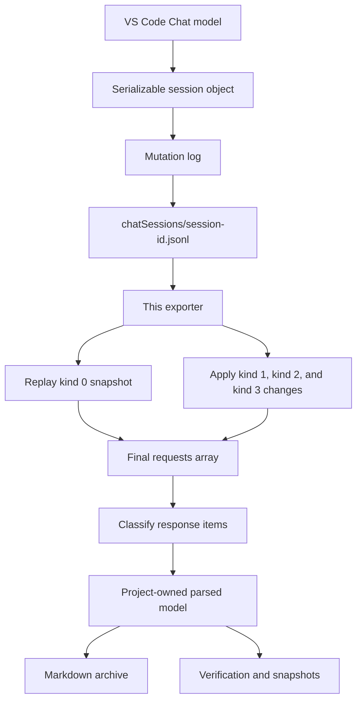
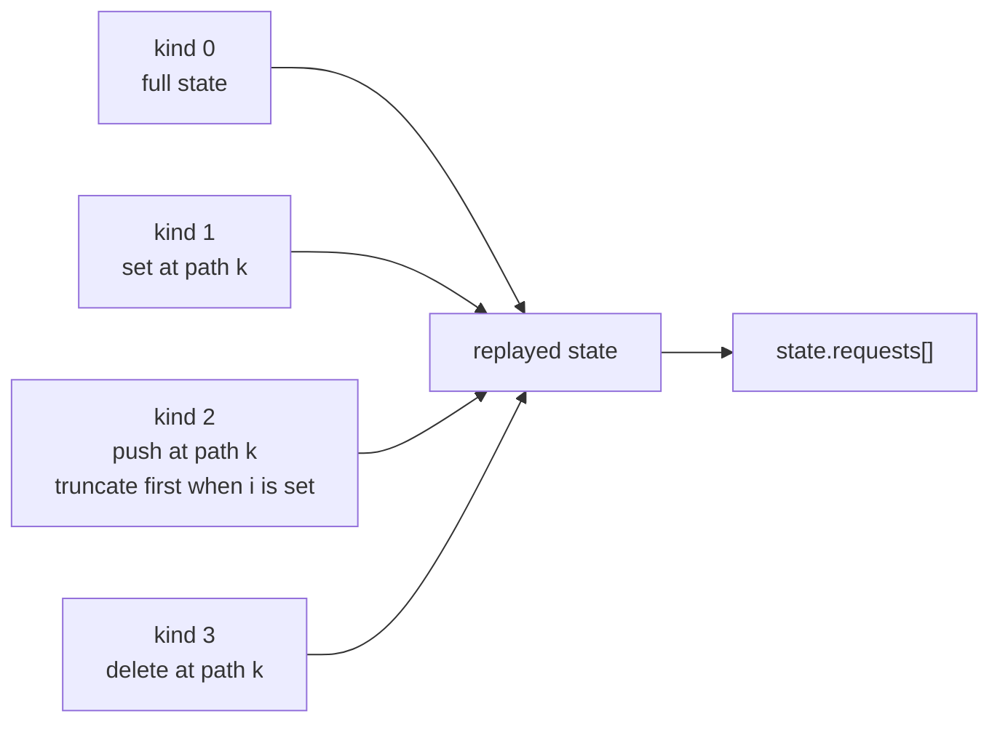
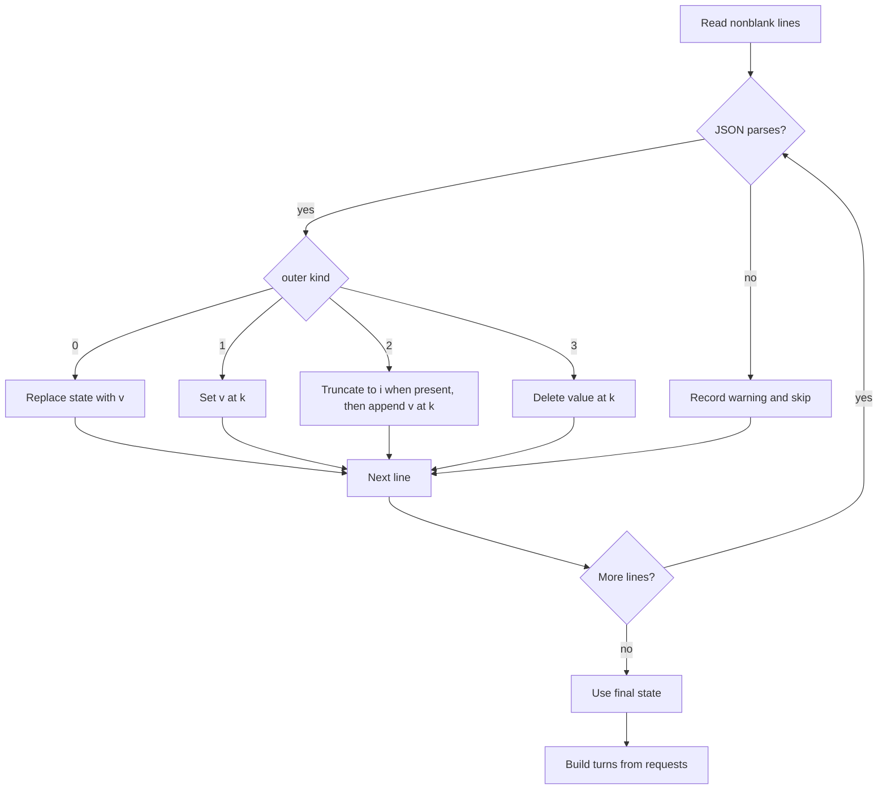
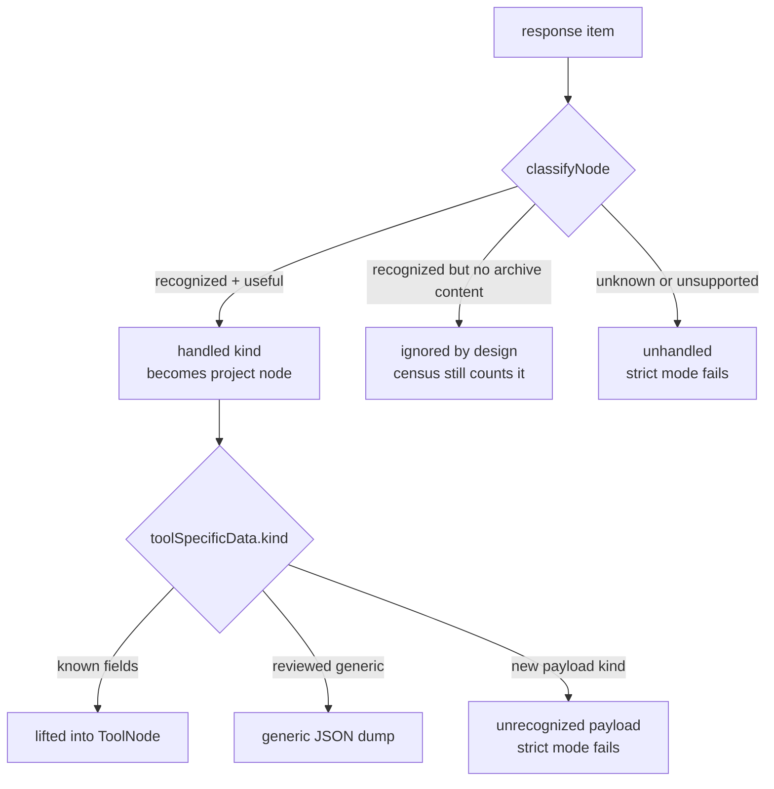
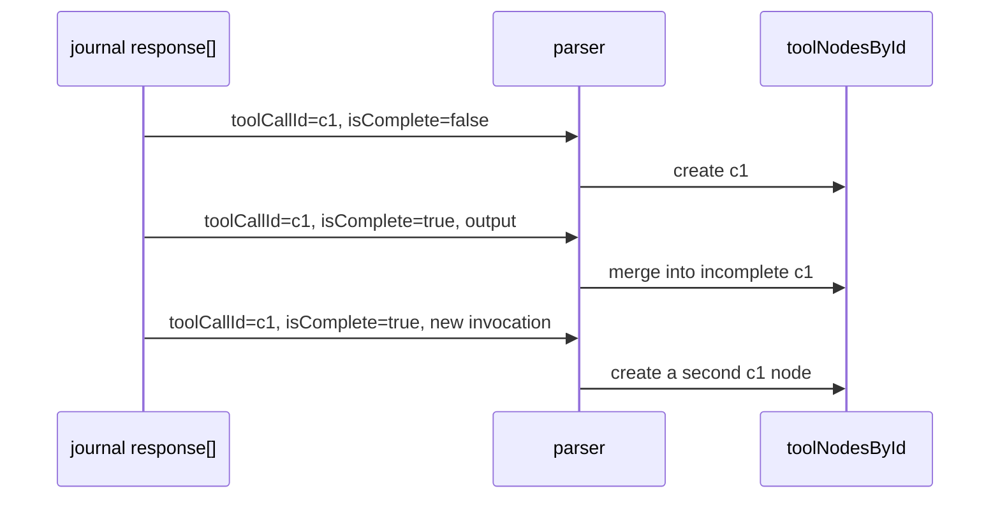
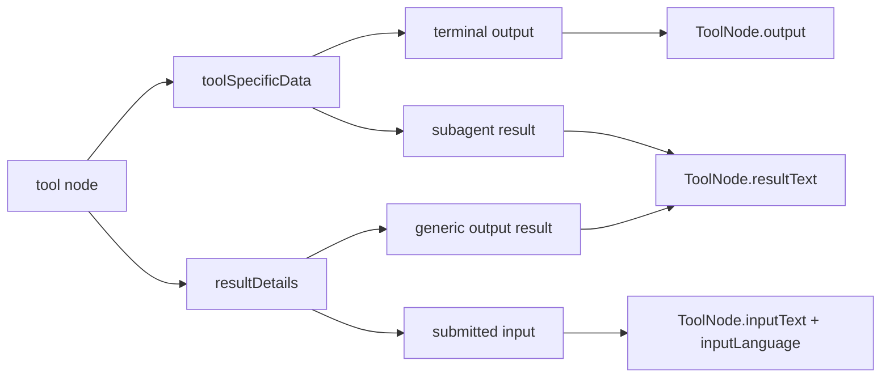
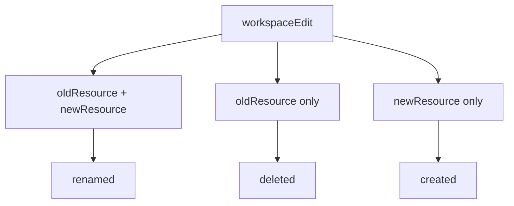
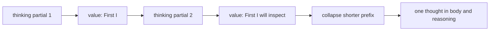
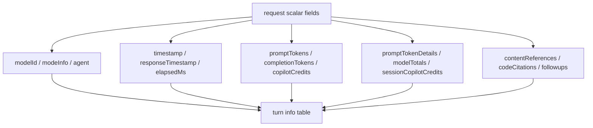
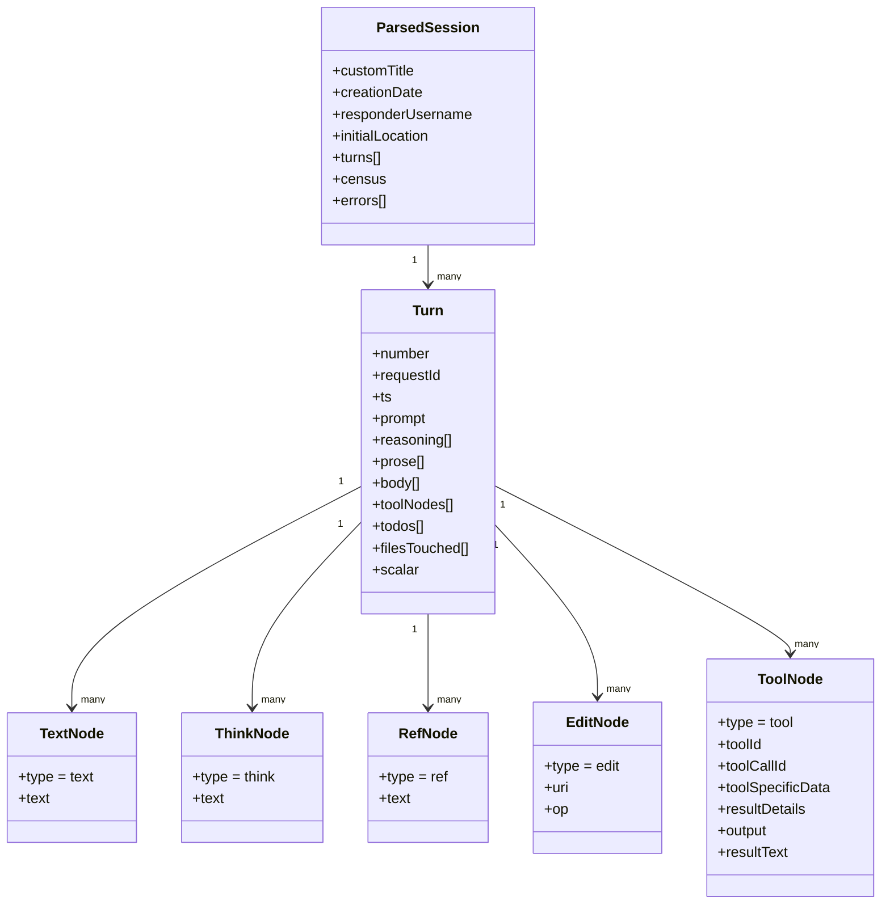

# VS Code Copilot Chat Session Data

A practical guide for maintaining this exporter.

This document describes the data that this project currently reads from VS Code Copilot Chat
sessions. It is written for someone joining the project who needs to understand the tree, find the
right code, and safely respond when VS Code changes its session format.

> **Important:** `chatSessions/<sessionId>.jsonl` is an internal VS Code storage format. It is not
a public, versioned API. The diagrams below combine official VS Code source with shapes observed
in this project's local sessions. Every section labels which kind of evidence it uses.

## Start Here

### Detailed listing enrichment

**Observed here / exporter policy:** [listing-evidence.ts](../src/session/listing-evidence.ts) adds read-only identification metadata after inventory verification. Its typed [contracts](../src/session/listing-evidence-types.ts) preserve title/date provenance, prompts, answering versus selected model evidence, edit/history state, artifacts, scoped sizes and diagnostics. Journal metadata comes from the same final replayed state as the exporter; a callback on `parseChatSession` observes that state without changing ordinary export output. Supported editing-history operations are counted only for matching recorded request IDs.

SDK prompt/model intervals use `eventsInScope`, with main settings sampled at prompt boundaries and assistant model IDs read only inside that scope. Child tasks require recorded scoped instructions or the unique parent tool call's task arguments. Source changes after inventory omit rich content instead of attaching stale or guessed evidence. Optional workspace scalar metadata is not a general YAML parser; malformed/duplicate/identity-conflicting metadata produces diagnostics.

Child title evidence also retains `description`/`name` from the unique `tool.execution_start` whose recorded tool-call ID matches the verified child scope, plus matching `subagent.started.agentDisplayName`. The detailed renderer considers real titles across all grouped references before these recorded task labels; synthetic UUID labels do not override a real title. This does not modify inventory identity or console headings. Optional Local usage evidence reads numeric finite nonnegative request `copilotCredits` and nonnegative safe-integer `promptTokens`/`completionTokens`. No string coercion or token-to-credit conversion occurs. Each session metric sums counted requests once, with independent coverage and labelled partial totals; missing counters remain unknown.

Observed in the sampled SDK log: `model.model_call_success.responseChunk.usage` token counters, agent-scoped `subagent.completed.totalTokens`, cumulative `session.usage_checkpoint` quota fields and `session.shutdown.modelMetrics` usage. These have different aggregation and identity semantics. Their correlation to report turns is deferred; the report explicitly shows unsupported/missing usage rather than assigning parent totals to children or treating cumulative checkpoints as increments.

Tool file changes describe submitted patches/text changes, not current file diffs. Uncovered text-edit markers and bounded large-text diff approximations are labelled estimates. Windows serialized URI and tool paths share a comparison identity; POSIX case is preserved. Unsupported editing arguments make totals partial, not falsely zero. Missing/pruned editing histories and removed file content stay unknown.

[listing-relationships.ts](../src/session/listing-relationships.ts) keeps persisted parents/peers/forks separate from best-effort copy/fork hints. Prompt similarity is never used as backing identity, grouping or export-selection evidence. The report preserves existing inventory status semantics and explicitly states that verified SDK backing is not SDK Markdown support.

### Provider-backed SDK sources

The inventory now distinguishes Local content version 3, chat index version 1 and SDK event version 1 as independent formats. Agent Host and Copilot CLI backings are verified for listing and scope selection; SDK Markdown rendering and semantic fidelity verification are not yet implemented.

| Source | Evidence used for identity | Missing/ambiguous behavior |
| --- | --- | --- |
| Agent Host main/peer | Exact owning `copilotcli:/<id>` and `ahp-chat` URI; central `agent-host.db` chat catalog's JSON `sdkSessionId`; legacy exact-chat/default metadata only when no central entry exists | Keep unresolved. A default-chat provider-ID fallback additionally requires its local database and a matching SDK header; retain explicit warnings. Never guess peer backings. |
| Copilot CLI | Exact indexed ID, local SDK folder and single matching `session.start`; verify `workspace.yaml` ID when present | Reject placeholders, conflicting IDs, invalid UTF-8 or malformed/incomplete logs. Optional metadata is not a substitute for event-header validation. |
| Subagent | Persisted `subagent.started` toolCallId-to-agentId mapping; exact parent tool execution for immediate parent links | Main identity can remain verified while affected children stay unresolved. No title/path-based bindings. Peer origin requires a unique match across the exact owning session's persisted catalog; unreadable candidates prevent uniqueness claims. |

**Inferred from pinned source:** [agentPeerChats.ts](https://github.com/microsoft/vscode/blob/07f806f999227108933c2e30515b26eecc1fda74/src/vs/platform/agentHost/node/agentPeerChats.ts) encodes provider backings with `sdkSessionId`; [agentHostPeerChatStore.ts](https://github.com/microsoft/vscode/blob/07f806f999227108933c2e30515b26eecc1fda74/src/vs/platform/agentHost/node/agentHostPeerChatStore.ts) treats the central catalog as authority and legacy metadata as compatibility data. The default provider-ID fallback exists in `CopilotAgent._sdkConversationId`; allowing it offline under stronger checks and warnings is an explicit exporter policy, not proof of a persisted mapping.

**Observed here:** SDK headers and top-level agent attribution in the private read-only corpus. [sdk-events.ts](../src/session/sdk-events.ts) retains every raw event field without text trimming or payload clipping. Schema-envelope verification does not establish that all unknown event semantics are handled by a renderer. SHA-256 records the verified bytes; cached scope evidence detects size/mtime changes but is not an atomic cross-store snapshot.

There are two different things called a chat export:

| Thing | What it is | Stable? |
|---|---|---|
| VS Code **Chat: Export Chat...** | A user-facing JSON export containing prompts and responses | Documented as a feature, but its exact file shape is owned by VS Code |
| `chatSessions/<sessionId>.jsonl` | VS Code's local mutation log for the live chat model | Internal storage; this is what this tool reads |

This exporter reads the second one because it preserves the response stream, tool lifecycle, file
edits, and data that the user-facing export does not expose in the same way.

The safest mental model is:



**Local evidence:** `src/session/journal.ts` performs the replay. **Official source:** VS Code's
`ChatSessionOperationLog` explains that the log exists to append mutations instead of repeatedly
serializing a long conversation.

## Evidence Levels

Use these words precisely when changing the parser:

- **Documented:** stated in official VS Code documentation or represented by a public or internal
  TypeScript declaration in the VS Code source.
- **Inferred from source:** visible in VS Code implementation, but not promised as a public file
  contract.
- **Observed here:** found in the local session corpus or the committed fixture.
- **Unknown:** not seen or not established. Do not guess it into a handler.

The official source is excellent evidence of what VS Code currently serializes. It is not a promise
that the private journal will remain unchanged.

## On-Disk Layout

**Observed here, with official source support for the names:**

```text
VS Code user data
└── User/workspaceStorage/<workspace-hash>/
    ├── workspace.json
    │   └── folder / workspace identity used by this exporter
    ├── state.vscdb
    │   └── chat.ChatSessionStore.index: current GUI title keyed by sessionId
    ├── chatSessions/
    │   └── <sessionId>.jsonl                 definitive journal for this tool
    └── GitHub.copilot-chat/
        ├── chat-session-resources/<sessionId>/
        │   └── large persisted tool-result bodies, when present
        ├── transcripts/<sessionId>.jsonl
        │   └── optional tool-argument enrichment, NOT the chat journal
        ├── debug-logs/<sessionId>/models.json
        │   └── model id to friendly display name
        └── memory-tool/memories/
            ├── <base64(sessionId)>/           session memory
            ├── repo/                          repository memory
            └── *.md                           user memory
```

The storage root varies by platform and VS Code channel. The owning code is
[src/host.ts](../src/host.ts), especially `workspaceStorageRoots()`, `resolveWorkspaceRoot()`, and
`createHostContext()`.

The listing inventory also reads optional `workspace.json` once per workspace storage folder and retains its `folder` or `workspace` URI in source provenance. HTML details show the storage-folder ID and explicitly labelled URI-basename workspace/project names; they do not infer names from the hash or inspect multi-root folder membership. Missing metadata does not prevent discovery; malformed/unreadable metadata produces a diagnostic while conversation verification continues independently. Generated Local and provider child rows retain this workspace provenance. File links are navigational hints, not proof that the targets still exist.

### Do not confuse these files

| File | Used by this exporter? | Why |
|---|---:|---|
| `state.vscdb` | Yes, for titles | `chat.ChatSessionStore.index.entries[sessionId].title` holds the current GUI title, including manual renames that may not update the journal |
| `chatSessions/<id>.jsonl` | Yes | The final persisted chat model, written as mutation records |
| `transcripts/<id>.jsonl` | Yes, optional enrichment | A different event/debug format. It can retain tool arguments, including V4A `apply_patch` bodies, but does not contain the journal's request tree |
| `debug-logs/<id>/models.json` | Optional enrichment | Friendly model names |
| `chat-session-resources/<id>/...` | Optional enrichment | Large tool results that are not inline in the journal |
| `memory-tool/memories/...` | Optional enrichment | Memory and plan files shown in the archive |

The rejection of a transcript path is intentional. A transcript can be valid JSONL and still be
the wrong schema.

### Transcript patch enrichment

The exporter correlates transcript `assistant.message` tool requests and `tool.execution_start`
records to journal tool nodes by `toolCallId`. Lifecycle copies are deduplicated, execution-start
arguments take precedence, and a call with `tool.execution_complete.success: false` is excluded.
Successful or status-unknown V4A patches provide file operation, added-line count, deleted-line
count, and exact recorded diff fragments. They do not control turn order or create chat turns.

V4A patch blocks provide changed lines and context, not complete before-and-after snapshots or
dependable hunk line numbers. Counts therefore represent submitted operations. Editing the same
line in multiple calls counts each operation, and the totals must not be described as the final
Git diff. Missing transcripts degrade to journal-derived file paths with change details unavailable.

### Title precedence

Getting the title for a chat session is not straightforward - the vscode copilot chat schema is confusing with multiple entries for title scattered across various files/locations/dbs and then user can rename the chat session which changes it in a very non-intuitive place. So it's important to read this before making changes to title related code. For the complete title vocabulary, storage map, source links, and code-change guidance, see
[CHAT-SESSION-TITLES.md](CHAT-SESSION-TITLES.md).

VS Code can leave an older `customTitle` in `chatSessions/<id>.jsonl` after the user renames the
session in the Chat GUI. The workspace index is therefore authoritative for the current display
title:

1. `state.vscdb` key `chat.ChatSessionStore.index`, entry keyed by `sessionId`;
2. latest root-level journal replacement `{ "kind": 1, "k": ["customTitle"], "v": "..." }`;
3. `customTitle` in the initial journal snapshot.

The index is title metadata only. The journal remains authoritative for prompts, responses, tools,
edits, and per-turn metadata.

## The Journal Envelope

A journal is **JSON Lines**: one JSON object per physical line. In the sessions observed here, the
outer record has one of these shapes:

```json
{"kind":0,"v":{...full session state...}}
{"kind":1,"k":["requests",0,"response"],"v":[...items to set...]}
{"kind":2,"k":["requests"],"v":[...request objects to append...]}
{"kind":2,"k":["requests"],"i":10,"v":[...replacement requests...]}
{"kind":3,"k":["requests",0,"responseId"]}
```

The outer `kind` is the **mutation operation**, not the kind of a response item.



### Outer record fields

| Field | Meaning | Evidence |
|---|---|---|
| `kind: 0` | Initial full state snapshot | Observed here; matches the replay code |
| `kind: 1` | Set or replace a value at path `k` | Observed here; matches the replay code |
| `kind: 2` | Optionally truncate the array at `k` to length `i`, then append values from `v` | Official VS Code source; observed here |
| `kind: 3` | Delete the value at path `k` | Official VS Code source; handled by the replay code |
| `k` | Array of property names and array indexes | Observed here |
| `v` | Value for kinds 0 and 1; optional array of values for kind 2 | Official VS Code source; observed here |
| `i` | Optional new array length applied before a kind 2 append | Official VS Code source; observed here |

The first record normally carries the session header and an initial `requests` array. Later records
add requests, response items, metadata, and streamed updates.

## Replay Rules

The exporter does not parse each line as an independent conversation. It reconstructs state first.



### Paths

A path is a mixed array of property names and numeric indexes:

```json
["requests", 3, "response"]
```

means:

```text
state
└── requests[3]
    └── response
```

A path can target a nested object or array. The replay helpers create an array when the next path
component is numeric and an object otherwise.

### Indexed push and replacement

VS Code names `kind: 2` `Push`, but it is not always append-only. When `i` is present, replay first
sets the target array's length to `i`. It then appends `v` when `v` is present and nonempty.

```json
{"kind":2,"k":["requests"],"i":10,"v":[{"requestId":"replacement"}]}
{"kind":2,"k":["requests",10,"response"],"i":2}
```

The first record removes every request at index 10 and later, then inserts the replacement. The
second truncates a response array to two items without appending anything.

Ignoring `i` caused a confirmed exporter failure: a superseded request remained in the array, the
export showed 28 turns while VS Code showed 27, and later updates addressed the wrong exported
turn. Exact replay removed the stale request and restored the correct prompt and response order.

### Incident record: extra question and shifted responses (2026-08-27)

This section preserves why replay changed. It belongs here rather than in a separate bug log because
the defect was a misunderstanding of the journal contract, and this guide is the maintenance source
for that contract.

**Observed failure.** Session `dd0c0407-1d1b-4a0f-8424-a056fdcec2d8` showed 27 requests in the VS
Code Chat UI but exported 28. A localization question appeared twice instead of the later prompt
`yes`. Near the end, the package-name question owned response content from the following
implementation request, while the final exported turn held only an initial fragment.

**Evidence that separated cause from symptoms.** The raw journal later updated
`requests[26]`, while the exporter associated index 26 with the package-name request. The exporter
had retained one earlier request that VS Code had replaced, so every later index was off by one.
The affected session contained no `/compact` prompt or `Compacted conversation.` response, which
ruled out compact handling as the cause.

**Root cause.** The old replay treated every `kind: 2` record as append-only and ignored `record.i`.
VS Code's `ObjectMutationLog` defines kind 2 as `Push`, with optional `i` and `v`. Its `_applyPush`
sets `array.length = i` when `i` is present, then pushes `v` when values are present. In the failing
session, this truncated the request array at the stale slot and appended its replacement. Skipping
the truncation preserved both requests.

**Why the symptom appeared much later.** `ChatSessionOperationLog` adapts both the session
`requests` array and each request's `response` array through the mutation log. Later records use
numeric paths such as `['requests', 26, 'response']`. Once one stale request remains, those valid
paths still replay without an exception but mutate the wrong request. This produces plausible but
incorrect output, so prompt-specific reconciliation would hide the first error rather than fix it.

**Implemented solution.** Replay now follows VS Code semantics for all mutation kinds:

1. kind 0 replaces state with the initial snapshot;
2. kind 1 sets the value at `k`;
3. kind 2 truncates the target array to `i` when present, then pushes `v` when present;
4. kind 3 deletes the property at `k`.

The same rules apply to request arrays and response arrays. Truncation-only kind 2 records, where
`i` exists and `v` does not, are supported.

**Compaction decision.** The old parser remapped updates away from `/compact` requests and later
moved `Compacted conversation.` back. Replaying the committed live fixture with correct `i`
semantics placed all four confirmations on their recorded `/compact` requests without either
workaround. Both ownership-changing repairs were removed. Replay now trusts the recorded path for
all prompts; `/compact` remains special only in render verification, which checks that a recorded
confirmation was not dropped.

**Regression coverage.** Focused tests cover request replacement, response truncation without
values, property deletion, and compact confirmation ownership. The golden fixture appends a stale
request and replaces it using `i`, while preserving the same ten-turn digest and 993-line render.
The corrected live session exports 27 turns, and the large fixture exports 72 turns with four compact
confirmations correctly placed.

**Source references:**

- [`objectMutationLog.ts`](https://github.com/microsoft/vscode/blob/main/src/vs/workbench/contrib/chat/common/model/objectMutationLog.ts)
  defines mutation kinds 0 through 3 and implements truncate-then-push behavior in `_applyPush`.
- [`chatSessionOperationLog.ts`](https://github.com/microsoft/vscode/blob/main/src/vs/workbench/contrib/chat/common/model/chatSessionOperationLog.ts)
  applies the mutation log to serialized chat sessions, including request and response arrays.
- [Focused replay tests](../test/journal.test.ts) and the
  [golden journal](../test/fixtures/golden/00000000-0000-4000-8000-000000000000.jsonl) preserve the
  local regression cases.

### Numeric-keyed splice objects

**Observed in the committed fixture and handled defensively:** an append value may be an object
whose keys are numeric strings instead of a JSON array.

```json
{
  "kind": 2,
  "k": ["requests", 4, "response"],
  "v": {
    "0": {"value": "first"},
    "1": {"value": "second"}
  }
}
```

`requestValues()` turns that into two values in numeric order. This shape was not found in the
45-session survey, so the fixture deliberately constructs it. Keep this handler unless local
source proves the format no longer needs it.

### Replay pseudocode

```text
state = null
for each nonblank JSON line:
    if record.kind == 0:
        state = record.v
    else if record.kind == 1:
      setAtPath(state, record.k, record.v)
    else if record.kind == 2:
      pushAtPath(state, record.k, record.v, record.i)
    else if record.kind == 3:
      deleteAtPath(state, record.k)

requests = state.requests or []
```

The real implementation also records parse warnings. Read [session/journal.ts](../src/session/journal.ts)
before changing these rules.

## The Session Tree

After replay, the important tree is:

```mermaid
flowchart TD
    S[Session header + requests[]]
    S --> H[Header]
    S --> R[Request / turn]
    R --> M[message]
    R --> P[response[]]
    R --> X[per-request scalar fields]
    M --> MT[text or parts]
    P --> N[response item]
    N --> K[kind discriminator]
    N --> T[toolInvocationSerialized]
    N --> TH[thinking]
    N --> TXT[implicit assistant text]
    N --> E[textEditGroup / workspaceEdit]
    N --> I[inlineReference]
    N --> D[other response kind]
    T --> SD[toolSpecificData]
    SD --> TK[tool payload kind]
```

A **turn** in this project's parsed model is one request plus its response. It is not necessarily
one physical journal record. A turn can be assembled from many `kind: 1` and `kind: 2` records.

## Session Header

### Current persisted header

**Official source, current VS Code model:** `ISerializableChatData3` has these fields:

```ts
interface ISerializableChatData3 {
  version: 3;
  sessionId: string;
  creationDate: number;
  customTitle: string | undefined;
  initialLocation: ChatAgentLocation | undefined;
  responderUsername: string;
  requests: ISerializableChatRequestData[];
  hasPendingEdits?: boolean;
  inputState?: ISerializableChatModelInputState;
  repoData?: IExportableRepoData;
  pendingRequests?: ISerializablePendingRequestData[];
  workingDirectory?: string;
}
```

**Observed in this project:** the first record contains the identity fields and `requests`. The
parser reads these session-level fields:

```ts
customTitle
creationDate
responderUsername
initialLocation
hasPendingEdits
inputState
repoData
pendingRequests
workingDirectory
requests
```

They are preserved in `ParsedSession` and in the importable JSON representation under its
`session` object. They are not currently rendered into the Markdown archive. That is a display
boundary, not a loss during parsing.

### Header ownership

| Question | Owner |
|---|---|
| Where is the session file? | `session/locate.ts` + `host.ts` |
| How is the header found? | `session/journal.ts` |
| Which header fields become output metadata? | `session/journal.ts` and `markdown.ts` |
| Which fields are parsed but not currently rendered? | `types.ts` and the session metadata block |

## Requests: One Turn's Input and Output

The official `ISerializableChatRequestData` extends response metadata and currently includes:

```ts
interface ISerializableChatRequestData {
  requestId: string;
  message: string | IParsedChatRequest;
  variableData: { variables: unknown[] };
  response: SerializedChatResponsePart[] | undefined;

  timestamp?: number;
  responseTimestamp?: number;
  responseId?: string;
  modelId?: string;
  modeInfo?: object;
  agent?: object;
  result?: object;
  modelState?: object;
  isCanceled?: boolean;             // deprecated compatibility field
  followups?: unknown[];
  usedContext?: object;
  contentReferences?: unknown[];
  codeCitations?: unknown[];
  timeSpentWaiting?: number;
  promptTokens?: number;
  completionTokens?: number;
  outputBuffer?: number;
  promptTokenDetails?: Array<{
    category: string;
    label: string;
    percentageOfPrompt: number;
  }> | { cacheReadTokens?: number; cacheWriteTokens?: number };
  copilotCredits?: number;
  modelTotals?: unknown[];
  sessionCopilotCredits?: number;
  elapsedMs?: number;

  editedFileEvents?: unknown[];
  hiddenFromTranscript?: boolean;
  isSystemInitiated?: boolean;
  systemInitiatedLabel?: string;
  terminalExecutionId?: string;
  origin?: object;
}
```

The exact declarations evolve in VS Code. The important maintenance rule is that request metadata
is attached to the request object, while response content is in `request.response[]`.

```mermaid
flowchart LR
    R[request] --> ID[requestId]
    R --> MSG[message]
    R --> SC[scalar metadata]
    R --> RESP[response[]]
    MSG --> PROMPT[user prompt]
    SC --> MODEL[model / mode / agent]
    SC --> COST[tokens / credits / elapsed]
    SC --> STATE[modelState / cancellation]
    RESP --> STREAM[ordered response items]
```

### Message shape

Two forms matter:

```json
{"message":"old-format prompt"}
```

or:

```json
{
  "message": {
    "text": "prompt text",
    "parts": []
  }
}
```

**Official source:** current serialized requests allow either a string or parsed request object for
backward compatibility. **Observed here:** most current local requests expose `message.text`.
`messageText()` supports the object form and message parts.

### Response order is meaningful

The response array is a stream-shaped list. Do not group it by category.

```text
response[]
├── { value: "I will inspect the file." }
├── { kind: "thinking", value: "First I will..." }
├── { kind: "toolInvocationSerialized", toolCallId: "call_1", ... }
├── { value: "The command returned..." }
├── { kind: "textEditGroup", ... }
└── { value: "The change is complete." }
```

The project converts this to `Turn.body` while preserving that order. The renderer walks
`Turn.body` in order, so prose before a tool stays before it in the Markdown archive.

## Response Items and the `kind` Field

The response item's `kind` is the discriminator for structured items. Assistant prose is the
important exception: **observed here, it has no `kind`; it is recognized by shape as an object with
a string `value`.**

### Response kinds currently observed here

The following census came from the project's real 72-turn session and the extended committed
fixture:

| Response kind | Current handling | Parsed result |
|---|---|---|
| no kind + string `value` | classify as assistant text | `TextNode` |
| `thinking` | read `value`, discard empty partials, collapse prefixes | `ThinkNode` and `Turn.reasoning` |
| `markdownContent` | Defined by current VS Code source, but not seen in this project's persisted journal; persisted Markdown is currently observed as kind-less `{value: string}` | Handled for forward compatibility; current corpus does not exercise the named kind |
| `toolInvocationSerialized` | read tool identity and payload | `ToolNode` |
| `inlineReference` | reduce URI/reference to a readable label | `RefNode` |
| `textEditGroup` | read edited URI | `EditNode` |
| `workspaceEdit` | one item can produce several file operations | multiple `EditNode`s |
| `questionCarousel` | currently deliberately ignored | census only |
| `confirmation` | currently deliberately ignored | census only |
| `progressMessage` | currently deliberately ignored | census only |
| `progressTaskSerialized` | currently deliberately ignored | census only |
| `codeblockUri` | currently deliberately ignored | census only |
| `undoStop` | currently deliberately ignored | census only |

The current real-session counts are recorded by `--verify`; do not copy the example counts above
into code. Run the census against a new session after a VS Code update. The `markdownContent` row
is intentionally called out because official source names it while the current journal writer
serializes ordinary Markdown to a kind-less value object. That is an observed persistence detail,
not a promise that the wrapper can never appear.

### Current persisted kinds not observed here

Current VS Code source permits these additional named kinds in a serialized response:

| Family | Persisted `kind` values not observed in this corpus |
|---|---|
| Text and status | `markdownVuln`, `warning`, `info`, `systemNotification`, `command` |
| Structured views | `treeData`, `multiDiffData`, `extensions`, `pullRequest`, `planReview` |
| Editing and control | `notebookEditGroup`, `externalEdit`, `clearToPreviousToolInvocation` |
| Agent and model state | `hook`, `elicitationSerialized`, `disabledClaudeHooks` |

These names stay in `KNOWN_UNSEEN_KINDS`, not `IGNORED_RESPONSE_KINDS`. If one reaches a real
journal, the census still reports it and strict mode fails until its archive behavior is reviewed.
`autoModeResolution` used to be in this list. It is now observed and handled, see below.
Active-only kinds such as `toolInvocation`, `elicitation2`, `progressTask`, and `voiceProgress` are
not part of the normal serialized union. `disabledClaudeHooks` is a compatibility exception that
the serialized response-part type admits explicitly.

That difference is expected. A declaration is not the same as an observed journal example, and an
observed example is not the same as a promise that the kind will remain unchanged.

### `autoModeResolution`

Observed in a real corpus (23 records in 22 journals) and handled in `HANDLED_RESPONSE_KINDS`. It
records which model Auto picked for one request, so it is request metadata, not response content.
Two shapes exist:

| Shape | Fields |
|---|---|
| Newer | `resolved: { id, name }` |
| Older | flattened `resolvedModel`, `resolvedModelName`, plus a router `confidence` number and `predictedLabel` |

`classifyNode` normalizes both into an `autoModel` node (`modelId`, `modelName`, `confidence`,
`predictedLabel`). `parseChatSession` moves these out of the turn body into
`turn.scalar.autoModelResolutions`, and the Markdown turn-info table shows an "Auto resolved model"
row only when one was recorded. A record that names no model produces nothing, which is still not
drift because the kind is handled. Test: `test/classify.test.ts`, `test/journal.test.ts`,
`test/markdown.test.ts`.

Not done: the detailed listing still derives answering models from `toolCallRounds` and
`result.metadata.resolvedModel`; using this record there is a possible improvement.

### The three lists in this project

`session/classify.ts` keeps these lists beside `classifyNode()`:



| List | Meaning | What to do when a new name appears |
|---|---|---|
| handled | The project has a branch and content reaches the archive | Add or update tests and output expectations |
| ignored | The project intentionally drops it because it is UI/control state | Confirm it carries no content needed by the archive |
| known but unseen | A documented or researched possibility, not a suppression | Leave it unsuppressed; it must alert if it appears |
| unhandled | Content may be silently lost | Inspect a real node before changing code |
| generic payload | Content is retained as JSON without specialized fields | Decide whether a specialized renderer is worth it |

An unknown response kind must never be added to the ignore list just to make a check green.

## Tool Invocation Nodes

### Outer tool item

The official current declaration for a serialized invocation contains the following important
fields:

```ts
interface IChatToolInvocationSerialized {
  kind: 'toolInvocationSerialized';
  toolCallId: string;
  toolId: string;
  invocationMessage: string | MarkdownString;
  pastTenseMessage?: string | MarkdownString;
  originMessage?: string | MarkdownString;
  toolSpecificData?: SerializedToolSpecificData;
  resultDetails?: Array<URI | Location>
    | IToolResultInputOutputDetails
    | IToolResultOutputDetailsSerialized;
  isConfirmed?: boolean | object;
  isComplete: boolean;
  source?: string;
  subAgentInvocationId?: string;
  generatedTitle?: string;
}
```

**Observed here:** the exporter sees repeated serialized items for the same `toolCallId` as a
call moves from incomplete to complete. It merges only while the stored call is incomplete.
After completion, a later item with the same id is treated as a new invocation. This matters
because VS Code can reuse an id for a repeated command.



A tool node in this project's model is:

```ts
interface ToolNode {
  type: 'tool';
  toolId: string;
  toolCallId: string;
  invocation: string;
  pastTense: string;
  title: string;
  isComplete: boolean;
  isConfirmed?: boolean | Record<string, unknown>;
  toolSpecificData: ToolPayload | null;
  resultDetails: unknown | null;
  command: string;
  promptText: string;
  inputText: string;
  inputLanguage: string;
  todos: TodoItem[] | null;
  output: string;
  resultText: string;
  exitCode: number | null;
  duration: number | null;
  fileUri: string;
}
```

This is a project-owned shape, not VS Code's shape. `classifyNode()` is the conversion boundary.

`toolId` is deliberately a string, not an enum. VS Code registers tools dynamically from built-in,
extension, MCP, user-defined, external, and agent-host sources. A tool name that has never appeared
in this project still becomes a `ToolNode`; compatibility depends on the serialized invocation,
payload, and result shapes rather than a hardcoded list of tool names.

### `toolSpecificData`

This is a second discriminator nested inside the tool item:

```mermaid
flowchart TD
    T[toolInvocationSerialized] --> D[toolSpecificData]
    D --> TERM["kind: terminal"]
    D --> TODO["kind: todoList"]
    D --> SUB["kind: subagent"]
    D --> INPUT["kind: input"]
    D --> OTHER["future or other kind"]
    TERM --> TC[commandLine + output + state]
    TODO --> TL[todoList[]]
    SUB --> SP[prompt + result + agent identity]
    INPUT --> IR[rawInput]
    OTHER --> JSON[generic JSON rendering]
```

#### Terminal payload

**Official source and observed here:**

```json
{
  "kind": "terminal",
  "commandLine": {
    "original": "node --check file.ts",
    "forDisplay": "node --check file.ts"
  },
  "terminalCommandOutput": {
    "text": "OK\n",
    "truncated": false,
    "lineCount": 1
  },
  "terminalCommandState": {
    "exitCode": 0,
    "duration": 1234
  }
}
```

The official declaration now includes more optional terminal fields: working directory, display
language, confirmation details, sandbox state, terminal session id, output truncation metadata,
and repair information. The project currently lifts the command, output, exit code and duration.
Do not assume `original` is the only command field; VS Code distinguishes the command that ran
from the command shown to the user.

#### Todo payload

```json
{
  "kind": "todoList",
  "todoList": [
    {"id":"one","title":"Inspect parser","status":"completed"},
    {"id":"two","title":"Add test","status":"in-progress"}
  ]
}
```

Statuses observed and declared by VS Code are `not-started`, `in-progress`, and `completed`.

#### Subagent payload

**Observed here and supported by current VS Code source:**

```json
{
  "kind": "subagent",
  "agentName": "Explore",
  "description": "Research the parser",
  "prompt": "Find the tool identity logic",
  "result": "The id is merged while incomplete"
}
```

The parent session does not necessarily contain the subagent's entire turn-by-turn conversation.
Current VS Code's local-to-Agent-Host import code explicitly carries the subagent summary prompt and
result, not an assumed complete child transcript in the parent response item.

#### Input payload

```json
{
  "kind": "input",
  "rawInput": {"query":"chat session storage"}
}
```

Current VS Code source uses this for tool input when a more specialized payload is not available.
This project renders `rawInput` as a `Tool input` JSON block before the tool result. It removes
`rawInput` from the later low-level details block so the same input is not repeated. A new `input`
shape should not be treated as an error merely because it is not a terminal or todo list.

#### Current serialized payload compatibility

The current serialized `toolSpecificData` union is fully covered by either specialized extraction
or the generic JSON renderer:

| Payload `kind` | Handling |
|---|---|
| `terminal`, `todoList`, `subagent` | Specialized readable fields and sections |
| `input` | `rawInput` becomes readable Tool input; remaining metadata stays in Tool details |
| `extensions`, `pullRequest`, `simpleToolInvocation`, `search`, `resources` | Reviewed generic Tool details JSON |
| `modifiedFilesConfirmation`, `agentFeedbackReviewConfirmation` | Reviewed generic Tool details JSON |
| `sessionCreated`, `generatedImage`, `automationConfigured` | Reviewed generic Tool details JSON |

`automationConfiguration` exists in the live invocation union but is intentionally omitted when
VS Code serializes a completed invocation. An unknown future payload kind is still retained as JSON
and reported by the payload census so it can be reviewed for a better specialized presentation.

### Result details

A tool can carry submitted input and result information in `resultDetails`, while terminal output
can be nested under `toolSpecificData.terminalCommandOutput`. A subagent result can be a plain
`toolSpecificData.result`. These are not interchangeable.

Observed Playwright calls store the submitted program beside their result:

```json
{
  "resultDetails": {
    "input": "return await page.title();",
    "inputLanguage": "javascript",
    "output": [{"type":"embed","isText":true,"value":"Example"}],
    "isError": false
  }
}
```

Current VS Code source defines three serialized result families:

| Result family | Persisted shape | Export behavior |
|---|---|---|
| Resource locations | `Array<URI | Location>` | Preserved in `Tool result details` JSON |
| Input/output details | `input`, optional `inputLanguage`, `output[]`, optional `isError`, optional `mcpOutput` | Text input and text output get readable sections; embeds, refs, errors, MCP metadata, and future fields remain in details JSON |
| Serialized data | `output: { type: 'data', mimeType, base64Data }` | Preserved in `Tool result details` JSON |

The classifier preserves the complete envelope as `ToolNode.resultDetails`. It also lifts
`resultDetails.input` into `ToolNode.inputText`, its language hint into `ToolNode.inputLanguage`, and
text output parts into `ToolNode.resultText`. The renderer emits readable `Tool input` before `Tool
result`, then emits any unconsumed remainder as `Tool result details` JSON. Fields already shown in
readable form are removed from the remainder, so the archive does not duplicate them. Terminal
input is likewise suppressed because the dedicated command block already shows it.

The generic details block uses the same redaction and 24 KiB clipping policy as other low-level
tool data. This preserves arbitrary current and future result fields without allowing one binary or
generated payload to dominate the archive.



The classifier routes these into project-owned fields so the renderer does not need to understand
VS Code's changing storage shapes.

## File Edits

There are multiple edit-related response shapes.

| Shape | Meaning | Current project result |
|---|---|---|
| `textEditGroup` | An edit group with a URI | One `EditNode` |
| `workspaceEdit` | A list of old/new resource pairs | One `EditNode` per operation |
| `codeblockUri` | A control marker associated with an edit/code block | Ignored by design |
| `externalEdit` | Newer external edit representation in VS Code source | Not observed here; census must alert if it appears |

`workspaceEdit` operations are positional:



The source declaration calls these `oldResource` and `newResource`. This project maps them to
`created`, `deleted`, or `renamed` and later groups the touched files per turn.

## Thinking and Compaction

### Thinking

A `thinking` item has a `value` that can be a string or an array of parts. VS Code source also
records reasoning duration in newer serialized forms.

This project:

1. reads the value with `thinkingText()`;
2. ignores an empty streamed partial;
3. removes shorter prefixes when a later item contains the completed text;
4. keeps the resulting thought at its recorded position in `Turn.body`;
5. also stores the deduplicated list in `Turn.reasoning`.



### `/compact`

`/compact` is a real request in observed sessions. Its confirmation is a standalone response append
whose text is `Compacted conversation.`

The parser previously remapped updates away from `/compact` requests and then ran a repair pass to
move the confirmation back. Those workarounds compensated for treating `kind: 2` as append-only.
After implementing `i`, native replay placed all four confirmations in the committed live fixture
on their recorded `/compact` requests. The remapping and repair pass were therefore removed.

Do not add prompt-specific ownership rules unless a raw journal, replayed with current VS Code
semantics, proves that the recorded path does not identify the intended request. The compact render
check remains in place to catch a missing confirmation.

## Metadata and Costs

The request carries scalar fields copied from the journal. The project uses these for the archive:



`TurnScalars` is project-owned and deliberately has an index signature because VS Code adds fields
faster than this archive needs to render them. When a new field becomes important, declare it in
`src/types.ts`, add it to the scalar collection list in `src/session/journal.ts`, and add a focused
test before adding a renderer row.

One caution from current VS Code source: usage can be updated more than once, and tool-loop turns
can involve more than one model request. Do not assume that summing every intermediate usage record
is the same as the final billed total.

## The Project-Owned Model

The conversion boundary is deliberately small:



The declarations live in [src/types.ts](../src/types.ts). The parser creates them in
[session/journal.ts](../src/session/journal.ts). The renderer consumes them in
[markdown.ts](../src/markdown.ts). This separation is the main defense against schema changes:
only the parser and classifier should know VS Code's private names.

### Node conversion table

| VS Code input | Project node | Conversion owner |
|---|---|---|
| kind-less `{value: string}` | `TextNode` | `classifyNode()` |
| `{kind: 'thinking'}` | `ThinkNode` | `classifyNode()` |
| `{kind: 'inlineReference'}` | `RefNode` | `classifyNode()` |
| `{kind: 'textEditGroup'}` | `EditNode` | `classifyNode()` |
| `{kind: 'workspaceEdit'}` | `EditNode[]` | `classifyNode()` |
| `{kind: 'toolInvocationSerialized'}` | `ToolNode` | `classifyNode()` |
| anything else | `null` plus census entry | `classifyNode()` + `journal.ts` |

`classifyNode()` may return one node, an array of nodes, or `null`. The array case is necessary
for a single `workspaceEdit` containing several file operations.

## What Is Not the Same Thing

These pairs are easy to confuse:

| Do not confuse | Difference |
|---|---|
| outer `kind` and response-item `kind` | Outer `kind` selects snapshot/set/push/delete; inner `kind` identifies response content |
| `toolId` and `toolCallId` | `toolId` names the tool; `toolCallId` identifies an invocation occurrence and may be reused |
| `toolInvocation` and `toolInvocationSerialized` | Live model object versus persisted/reloaded invocation; this exporter sees the serialized form |
| `response[]` and `response.entireResponse` | The journal has the serialized response array; VS Code's live model exposes richer response views |
| `markdownContent` and kind-less `{value}` | VS Code's live response model uses the named kind; the persisted journal observed here stores ordinary Markdown without that wrapper |
| `chatSessions` and `transcripts` | Different stores with different schemas |
| `thinking` count and thought text | Streamed partials can count in the census while producing no final thought node |
| `workspaceEdit` and `textEditGroup` | One describes old/new resources; the other describes an edit group tied to a URI |
| files mentioned in text and files touched by edits | Text can mention a file without a structured edit node |

## How to Investigate a Schema Change

Use a session recorded after the VS Code or Copilot update. An old session cannot reveal a new
schema: its bytes do not change when VS Code updates.

### 1. Find the change

```powershell
node src/cli.ts --verify --strict <new-session-id>
```

Read these lines:

```text
UNHANDLED kinds (content dropped in silence)
UNRECOGNIZED toolSpecificData kinds
```

The first means a response item was dropped. The second means the response survived through the
generic path but its nested payload kind is not on a reviewed list.

### 2. Save a small structural record

```powershell
node src/cli.ts --snapshot update <session-id>
```

This saves a few-KB digest in `test/snapshots/`. It records counts, order, file names, the census,
and hashes of prompt/assistant text. It does not preserve the full conversation contents.

### 3. Inspect the actual node

The name is not enough. Dump one real response item from the journal and redact any sensitive
content before sharing it. The existing procedure is in
[docs/UPGRADING.md](UPGRADING.md), Step 2.

Useful places to inspect, in order:

1. this project's local `classify.ts` and `journal.ts`;
2. local committed fixture and `--verify` census;
3. the matching VS Code source declaration in `chatService.ts` or `chatModel.ts`;
4. the matching VS Code implementation or tests;
5. official issue history if the change came from a migration or regression.

### 4. Add the smallest handler

Put the new branch in `classifyNode()` or add the nested payload to its handling list. Keep the
new branch at the conversion boundary. Do not spread the VS Code field name through the renderer.

### 5. Check the motivating session

```powershell
node src/cli.ts --snapshot check <session-id>
```

You want the census to show the new kind handled and the affected turns to regain the expected
nodes. A snapshot does not prove the output is semantically right, so also add a focused unit test
with a fabricated, minimal example of the shape.

### 6. Re-run the project gate

```powershell
npm run verify -w copilot-chat-exporter
node src/cli.ts --verify --strict <session-id>
```

Read the diff before re-recording the snapshot or golden fixture. A passing comparison means
"unchanged from the saved record", not "correct".

## Useful Commands

```powershell
# list sessions known to this machine
node src/cli.ts --list

# inspect a current or recent session
node src/cli.ts --verify --strict <session-id>

# record one session's structural digest
node src/cli.ts --snapshot update <session-id>

# compare after changing the parser
node src/cli.ts --snapshot check <session-id>

# run the committed, reviewable checks
npm run verify -w copilot-chat-exporter

# include the large machine-local baseline
npm run verify:local -w copilot-chat-exporter
```

## Sources and Search Results

### Official Microsoft and VS Code documentation

- [Manage agent sessions in VS Code](https://code.visualstudio.com/docs/agents/run/sessions/manage-sessions)
  documents sessions, compaction, multiple chats, session history, and the user-facing
  **Chat: Export Chat...** JSON command. It does not document the private `chatSessions/*.jsonl`
  mutation-log format.
- [Debug chat interactions](https://code.visualstudio.com/docs/agents/agent-troubleshooting/chat-debug-view)
  documents Agent Logs and Chat Debug View, including raw prompts, context, tool payloads, and
  exported OTLP debug sessions. These are useful complementary sources, not the local chat journal
  schema.
- [Use chat in VS Code](https://code.visualstudio.com/docs/chat/chat-overview) documents prompts,
  responses, tools, context, and session behavior at the product level.
- [Prompt files](https://code.visualstudio.com/docs/agent-customization/prompt-files) documents
  prompt-file locations and invocation, useful for the project's skill integration but not for
  journal parsing.

### Official VS Code source

These are the strongest technical references for current shapes, but they are internal source and
can change:

- [`chatSessionOperationLog.ts`](https://github.com/microsoft/vscode/blob/main/src/vs/workbench/contrib/chat/common/model/chatSessionOperationLog.ts)
  defines the mutation-log purpose, the storage schema, request fields, response-part persistence,
  and the distinction between dynamic and static response kinds.
- [`objectMutationLog.ts`](https://github.com/microsoft/vscode/blob/main/src/vs/workbench/contrib/chat/common/model/objectMutationLog.ts)
  defines kinds 0 through 3 and the exact kind 2 behavior: truncate to `i` when present, then append
  values from `v` when present.
- [`chatModel.ts`](https://github.com/microsoft/vscode/blob/main/src/vs/workbench/contrib/chat/common/model/chatModel.ts)
  defines `ISerializableChatData1/2/3`, request and response metadata, `IChatModel`, serialization,
  normalization, and compatibility behavior.
- [`chatService.ts`](https://github.com/microsoft/vscode/blob/main/src/vs/workbench/contrib/chat/common/chatService/chatService.ts)
  defines serialized tool invocations, terminal/todo/subagent/input payloads, response kinds,
  question carousels, confirmations, workspace edits, and usage fields.
- [`promptTokenDetails.ts`](https://github.com/microsoft/vscode/blob/main/extensions/copilot/src/platform/tokenizer/node/promptTokenDetails.ts)
  defines the category/label/percentage breakdown used by `promptTokenDetails` and shows how
  system instructions, tool definitions, messages, files, and tool results are classified.
- [`importLocalConversationToAgentSession.ts`](https://github.com/microsoft/vscode/blob/main/src/vs/workbench/contrib/chat/browser/agentSessions/agentHost/importLocalConversationToAgentSession.ts)
  shows current handling of markdown, reasoning, inline references, tool calls, subagent summaries,
  and the fact that other progress kinds are skipped during local-to-Agent-Host import.
- [`chatSessionStore.ts`](https://github.com/microsoft/vscode/blob/main/src/vs/workbench/contrib/chat/common/model/chatSessionStore.ts)
  shows session loading, normalization, and storage-location behavior.

### GitHub issues and community search

- The VS Code issue search for `chatSessions jsonl` returned current reports including
  [JSON-to-JSONL migration not performed](https://github.com/microsoft/vscode/issues/324959),
  [history missing when the JSONL file is absent](https://github.com/microsoft/vscode/issues/324662),
  and an [import-local-conversation change](https://github.com/microsoft/vscode/pull/324858).
  These support the practical conclusion that storage migrations and missing files are real failure
  modes, but they do not publish a stable JSONL schema.
- The former
  [`microsoft/vscode-copilot-release`](https://github.com/microsoft/vscode-copilot-release) issue
  tracker is archived and its relevant session issues are historical feedback rather than a schema
  authority.
- Reddit searches for `chat history jsonl` in `r/vscode` and `r/GithubCopilot` were attempted, but
  the fetcher returned no readable result beyond the Reddit shell page. No Reddit claim is used in
  this guide.
- Stack Overflow's tagged VS Code/Copilot listing returned HTTP 403 to the fetcher. No Stack
  Overflow claim is used in this guide.

## Maintenance Rules

1. Treat the journal as private input, not a supported API.
2. Replay the outer mutation log before interpreting requests.
3. Keep all VS Code-specific names in `session/classify.ts` and `session/journal.ts`.
4. Preserve response order; never bucket prose, thoughts, tools, and edits by type.
5. Treat a new kind as a question to investigate, not as an error to suppress.
6. Use the census to find drift and a session snapshot to measure the fix on the motivating session.
7. Add a small fabricated test for every newly handled shape.
8. Read verification diffs before re-recording them.
9. Keep raw contents out of structural snapshots; hashes and counts are enough for regression work.
10. When official source and local behavior disagree, record both and prefer the behavior required by
    the local journal until the difference is understood.

The parser's job is not to predict every future VS Code field. It is to preserve what the journal
contains, report what it cannot interpret, and make the conversion boundary easy to update when
that report arrives.
